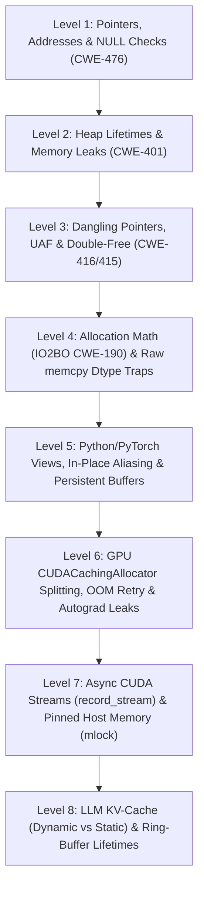

# Advanced ML Deep-System Low-Level Memory, GPU Allocator & Cache Fixes — Interactive Ladder Study Guide

> [!IMPORTANT]
> **How to use this Study Guide:**
> 1. **Interactive Web App (`ml_memory_ladder.html`):** Open `/home/droid/ml-memory-ladder/ml_memory_ladder.html` in any browser (desktop or mobile Safari). It follows the exact **ML Ladder** pattern (`Quiz` + `Code Labs` in both **Python** and **C++** + `Full Study Guide` tab).
> 2. **Grounded in Your Real Bug Ledger:** Every level and code lab is tied directly to real bugs you found, verified, or audited across `deepspeedai/DeepSpeed#8565`, `cfengine/core#6358`, `eclipse-mosquitto/mosquitto#3762`, `pytorch/executorch#23399`, `huggingface/transformers#48509/#48809`, `GPT-Neo StaticCache`, `Kornia ADA`, and `TorchMetrics Running` / `WrapperMetric`.
> 3. **Every Variable & Every Line Explained:** For all 16 exercises across 8 levels, every single variable, pointer, tensor metadata field, C++ line, and Python line is documented below.

## Ladder Architecture Overview



---

## 1. Pointers, Addresses & NULL Checks

### Level 1 Self-Check Quiz (8 Questions)

**Q1.1: In C and C++, what is a pointer variable (like `float *workspace`) in plain words?**
- **Correct Answer:** A small box that holds the memory address (numbered slot) where the real data lives
- **Why / Systems Mechanism:** Analogy: a pointer is a sticky note with a warehouse room number written on it, not the warehouse room itself. Copying the pointer only copies the sticky note.

**Q1.2: What do `malloc(bytes)` and `calloc(count, size)` return when the system runs out of memory (OOM)?**
- **Correct Answer:** They return `NULL` (address 0) to say no memory block could be reserved
- **Why / Systems Mechanism:** In C (`malloc`/`calloc`), allocation failure does NOT throw an exception; it quietly returns `NULL` (address `0`). If you don't check for `NULL`, the very next write crashes the process.

**Q1.3: What happens in C++ if `workspace = (float**)calloc(n, sizeof(float*))` returns `NULL` and the next line runs `workspace[0] = buf`?**
- **Correct Answer:** Undefined behavior and an immediate `SIGSEGV` crash from writing to address 0
- **Why / Systems Mechanism:** This is CWE-476 (NULL Pointer Dereference) — the exact bug you found and filed in `deepspeedai/DeepSpeed#8565` (`shm.cpp:390`) and `eclipse-mosquitto/mosquitto#3762` (`ctrl_shell.c`).

**Q1.4: How does `calloc(count, size)` differ from `malloc(count * size)` when allocation succeeds?**
- **Correct Answer:** `calloc` zeroes every byte of the new block and checks `count * size` for overflow
- **Why / Systems Mechanism:** `calloc` both zero-initializes the memory AND checks if `count * size` would overflow `size_t`, whereas `malloc` leaves uninitialized garbage bytes and takes a single already-multiplied size.

**Q1.5: Suppose a function allocates 3 buffers in a row (`a = calloc(...)`, `b = calloc(...)`, `c = calloc(...)`). What goes wrong if `c` is `NULL` and you just `return -1;`?**
- **Correct Answer:** Buffers `a` and `b` are leaked because nobody freed them before returning
- **Why / Systems Mechanism:** C++ has no automatic rollback for raw `calloc` calls. If allocation #3 fails after #1 and #2 succeeded, you must `free(a)` and `free(b)` before returning (`free(NULL)` is a safe no-op). You hit this exact compound-guard pattern in `DeepSpeed#8565`.

**Q1.6: Is calling `free(NULL)` in C/C++ a crash, or is it safe?**
- **Correct Answer:** It is guaranteed by the C/C++ standard to be a safe no-op (it does nothing)
- **Why / Systems Mechanism:** Because `free(NULL)` is guaranteed to do nothing safely, a single cleanup block can safely run `free(a); free(b); free(c);` when any one of them failed and is `NULL`!

**Q1.7: Why do C++ static analyzers sometimes miss `if ((p = calloc(n, sz)) == NULL)` if written carelessly?**
- **Correct Answer:** The assignment `p = calloc(...)` is wrapped inside `(...)` on the left of `== NULL`
- **Why / Systems Mechanism:** Real lesson from your Reagent `C07` detector (`httpd` `suexec.c`): the left-hand side of `== NULL` is the parenthesized assignment `(p = calloc(...))`, so the checker must unwrap the assignment to see that `p` IS guarded.

**Q1.8: Why do C and C++ parse `if (!a || !b)` differently inside tree-sitter AST tools?**
- **Correct Answer:** C wraps the `if` test in `parenthesized_expression`, while C++ uses `condition_clause`
- **Why / Systems Mechanism:** Real lesson #7 from your Reagent `C07` work on `DeepSpeed/csrc/cpu/comm/shm.cpp`: `.c` and `.cpp` grammars wrap `if` conditions in different AST node types (`parenthesized_expression` vs `condition_clause`).

### Lab 1.1 Unchecked calloc() NULL Dereference (DeepSpeed #8565 & Mosquitto #3762)

- **Real Bug Origin:** `deepspeedai/DeepSpeed#8565 (csrc/cpu/comm/shm.cpp:375-390) & eclipse-mosquitto/mosquitto#3762 (apps/mosquitto_ctrl/ctrl_shell.c:830)`

In C/C++, `calloc(num_workers, elem_bytes)` asks the operating system for a zeroed heap block. When memory is exhausted (`avail_bytes < num_workers * elem_bytes`), `calloc` returns `NULL` (in our Python model, `None`). The buggy starter code never checks for `NULL` and immediately indexes `workspace[i] = worker_addrs[i]`, crashing with a `SIGSEGV` (`TypeError` in Python). Fix `init_shm_workspace(num_workers, elem_bytes, avail_bytes, worker_addrs)` so that:
1. If `num_workers <= 0` or `calloc` returns `NULL`/`None` (which happens when `num_workers * elem_bytes > avail_bytes`), it immediately returns `None` (`NULL` in C++).
2. Otherwise, it copies each `worker_addrs[i]` into `workspace[i]` and returns `workspace`.

#### Every Variable & Parameter Explained

| Variable / Parameter | Exact Role in Hardware / RAM / VRAM & Failure Mode |
|---|---|
| `num_workers (int)` | How many distributed worker processes need a slot in the `workspace` pointer table (`size` in DeepSpeed's `shm_initialize`). |
| `elem_bytes (int)` | Byte size of a single slot in the table (in C++, `sizeof(struct allreduce_workspace*)`, which is 8 bytes on a 64-bit CPU). |
| `avail_bytes (int)` | How many free bytes remain in system heap memory right now. If `num_workers * elem_bytes > avail_bytes`, allocation fails. |
| `worker_addrs (list / const int*)` | The shared-memory buffer addresses (`workspace_buf_other` in DeepSpeed) to store into each slot `workspace[i]`. |
| `total_bytes (int / long long)` | Total bytes requested from the heap: `count * elem_bytes`. Cast to `long long` in C++ so the multiplication does not overflow 32-bit `int`. |
| `workspace (list or None / int*)` | The pointer returned by `sim_calloc`. Holds a valid zeroed array on success, or `None` / `NULL` (address 0) when allocation fails. |
| `i (int)` | Loop index stepping through each worker slot from `0` to `num_workers - 1`. |

#### C++ Buggy Starter vs. Verified Fix

**Buggy C++ Starter (RED — Fails Tests):**
```cpp
// Simulated C++ heap allocator for in-browser execution
int* sim_calloc(int count, int elem_bytes, int avail_bytes, int* out_buf) {
    long long total_bytes = (long long)count * (long long)elem_bytes;
    if (count <= 0 || total_bytes > (long long)avail_bytes) {
        return NULL;
    }
    for (int k = 0; k < count; k++) { out_buf[k] = 0; }
    return out_buf;
}

int init_shm_workspace(int num_workers, int elem_bytes, int avail_bytes, const int* worker_addrs, int* backing_buf) {
    int* workspace = sim_calloc(num_workers, elem_bytes, avail_bytes, backing_buf);
    // BUG (DeepSpeed shm.cpp:390): workspace is dereferenced without checking if (!workspace)!
    for (int i = 0; i < num_workers; i++) {
        workspace[i] = worker_addrs[i];
    }
    return 1; // 1 = success, -1 = NULL allocation failure
}
```

**Fixed C++ Solution (GREEN — Passes All Tests):**
```cpp
// Simulated C++ heap allocator for in-browser execution
int* sim_calloc(int count, int elem_bytes, int avail_bytes, int* out_buf) {
    long long total_bytes = (long long)count * (long long)elem_bytes;
    if (count <= 0 || total_bytes > (long long)avail_bytes) {
        return NULL;
    }
    for (int k = 0; k < count; k++) { out_buf[k] = 0; }
    return out_buf;
}

int init_shm_workspace(int num_workers, int elem_bytes, int avail_bytes, const int* worker_addrs, int* backing_buf) {
    int* workspace = sim_calloc(num_workers, elem_bytes, avail_bytes, backing_buf);
    if (workspace == NULL) {
        return -1;
    }
    for (int i = 0; i < num_workers; i++) {
        workspace[i] = worker_addrs[i];
    }
    return 1;
}
```

#### C++ Line-by-Line Walkthrough

| C++ Code Line | Detailed Low-Level Explanation |
|---|---|
| `// Simulated C++ heap allocator for in-browser execution` | Comment header: models `calloc` against a controlled heap budget `avail_bytes` so we can deterministically trigger OOM in tests. |
| `int* sim_calloc(int count, int elem_bytes, int avail_bytes, int* out_buf) {` | Defines `sim_calloc`: takes element count `count`, bytes per element `elem_bytes`, available heap `avail_bytes`, and backing storage `out_buf`; returns `int*` (or `NULL` on failure). |
| `    long long total_bytes = (long long)count * (long long)elem_bytes;` | Promotes both `32-bit int` operands to `64-bit long long` before multiplying so `count * elem_bytes` cannot overflow 32 bits. |
| `    if (count <= 0 \|\| total_bytes > (long long)avail_bytes) {` | Checks whether the caller asked for `<= 0` elements or more bytes than remain in the heap (`avail_bytes`). |
| `        return NULL;` | Models standard C `calloc` on OOM: returns `NULL` (memory address `0x0`) instead of throwing a C++ exception. |
| `    }` | Closes the OOM / invalid-count failure branch. |
| `    for (int k = 0; k < count; k++) { out_buf[k] = 0; }` | Models `calloc`'s zero-initialization guarantee: writes `0` into every slot `out_buf[0 .. count-1]`. |
| `    return out_buf;` | Returns the valid non-null base pointer `out_buf` to the caller. |
| `}` | Ends `sim_calloc`. |
| `int init_shm_workspace(int num_workers, int elem_bytes, int avail_bytes, const int* worker_addrs, int* backing_buf) {` | Entry function modeling `shm_initialize` in `deepspeed/csrc/cpu/comm/shm.cpp` (`DeepSpeed#8565`). |
| `    int* workspace = sim_calloc(num_workers, elem_bytes, avail_bytes, backing_buf);` | Requests `num_workers` slots of `elem_bytes` bytes each. `workspace` receives either a valid pointer or `NULL`. |
| `    if (workspace == NULL) {` | THE FIX (CWE-476 NULL guard): Explicitly tests if `workspace` is `NULL` before touching `workspace[i]`. |
| `        return -1;` | Returns error status `-1` cleanly instead of crashing the process with `SIGSEGV` at address `0x0`. |
| `    }` | Closes the `NULL`-check guard block. |
| `    for (int i = 0; i < num_workers; i++) {` | Loops `i` across all `num_workers` slots (`0` through `num_workers - 1`). |
| `        workspace[i] = worker_addrs[i];` | Dereferences `workspace + i` to store worker `i`'s shared-memory address (`shm.cpp:390`). Safe now because `workspace != NULL`. |
| `    }` | Ends the worker table initialization loop. |
| `    return 1;` | Returns `1` indicating `workspace` was allocated and populated without error. |
| `}` | Ends `init_shm_workspace`. |

#### Python Buggy Starter vs. Verified Fix

**Buggy Python Starter (RED — Fails Tests):**
```python
def sim_calloc(count, elem_bytes, avail_bytes):
    total_bytes = count * elem_bytes
    if count <= 0 or total_bytes > avail_bytes:
        return None
    return [0] * count

def init_shm_workspace(num_workers, elem_bytes, avail_bytes, worker_addrs):
    workspace = sim_calloc(num_workers, elem_bytes, avail_bytes)
    # BUG (DeepSpeed shm.cpp:390): no NULL/None check before writing workspace[i]!
    for i in range(num_workers):
        workspace[i] = worker_addrs[i]
    return workspace
```

**Fixed Python Solution (GREEN — Passes All Tests):**
```python
def sim_calloc(count, elem_bytes, avail_bytes):
    total_bytes = count * elem_bytes
    if count <= 0 or total_bytes > avail_bytes:
        return None
    return [0] * count

def init_shm_workspace(num_workers, elem_bytes, avail_bytes, worker_addrs):
    workspace = sim_calloc(num_workers, elem_bytes, avail_bytes)
    if workspace is None:
        return None
    for i in range(num_workers):
        workspace[i] = worker_addrs[i]
    return workspace
```

#### Python Line-by-Line Walkthrough

| Python Code Line | Detailed Low-Level Explanation |
|---|---|
| `def sim_calloc(count, elem_bytes, avail_bytes):` | Defines `sim_calloc`: models C's `calloc(count, elem_bytes)` against a finite heap budget `avail_bytes`. |
| `    total_bytes = count * elem_bytes` | Multiplies element count `count` by per-element byte size `elem_bytes` to compute total requested heap bytes. |
| `    if count <= 0 or total_bytes > avail_bytes:` | Checks whether the request is non-positive (`<= 0`) or exceeds remaining free heap (`> avail_bytes`). |
| `        return None` | Models C's `return NULL;`: returns `None` (no memory block) when allocation fails. |
| `    return [0] * count` | Models `calloc` zero-initializing all `count` slots of the newly allocated block. |
| `def init_shm_workspace(num_workers, elem_bytes, avail_bytes, worker_addrs):` | Entry function mirroring `shm_initialize` in `deepspeed/csrc/cpu/comm/shm.cpp` (`DeepSpeed#8565`). |
| `    workspace = sim_calloc(num_workers, elem_bytes, avail_bytes)` | Requests the zeroed pointer table from `sim_calloc`. `workspace` is now either a list of `num_workers` zeros OR `None`. |
| `    if workspace is None:` | THE FIX (CWE-476 NULL guard): Checks for allocation failure BEFORE indexing `workspace[i]`. |
| `        return None` | Aborts cleanly and returns `None` (`NULL`) instead of crashing with a `TypeError` / `SIGSEGV`. |
| `    for i in range(num_workers):` | Loops `i` from `0` to `num_workers - 1` (safe now because `workspace` is proven non-null). |
| `        workspace[i] = worker_addrs[i]` | Writes worker `i`'s shared-memory address into slot `workspace[i]` (`shm.cpp:390`). |
| `    return workspace` | Returns the initialized `workspace` array to the caller. |

### Lab 1.2 Compound Multi-Buffer Allocation & Partial-OOM Cleanup (DeepSpeed #8565 Commit 2)

- **Real Bug Origin:** `deepspeedai/DeepSpeed#8565 (shm.cpp:375-384 — 5 sibling calloc() calls needing a compound guard + cleanup)`

In `DeepSpeed#8565`, `shm_initialize` actually made 5 sibling `calloc()` calls in one block (`workspace`, `symmetric_buffer[0]`, `symmetric_buffer[1]`, etc.). When a function allocates multiple buffers in sequence (`buf_sizes = [sz0, sz1, ...]`) from a heap with `avail_bytes` free:
- Allocation `i` succeeds if `sz_i > 0` and `used_bytes + sz_i <= avail_bytes` (consuming `sz_i` bytes from the heap).
- If ANY allocation in `buf_sizes` fails (say buffer #2 exceeds remaining `avail_bytes`), you cannot just return early! Buffers #0 and #1 were already allocated and MUST be freed, or you leak them!
Write `alloc_all_or_cleanup(buf_sizes, avail_bytes)` that returns `[ok, active_allocs, bytes_leaked]`:
- If every buffer in `buf_sizes` fits within `avail_bytes` (and every `sz > 0`), return `[True, len(buf_sizes), 0]`.
- If any buffer fails (`sz <= 0` or not enough `avail_bytes` left), free all previously allocated buffers in that call and return `[False, 0, 0]`. (The buggy starter forgets to free earlier buffers on partial failure, returning non-zero `bytes_leaked`!)

#### Every Variable & Parameter Explained

| Variable / Parameter | Exact Role in Hardware / RAM / VRAM & Failure Mode |
|---|---|
| `buf_sizes (list[int] / const int*)` | Byte sizes of the sibling buffers that must all be allocated together (like `workspace`, `symmetric_buffer[0..1]`, `ernie_buffer[0..1]` in DeepSpeed). |
| `avail_bytes (int)` | Total free heap bytes available before the first allocation starts. |
| `allocated (list[int]) / active_count (int)` | Tracks each buffer that has already been allocated so far during this call. |
| `used_bytes (int)` | Running sum of heap bytes currently held by `allocated` buffers. |
| `sz (int)` | Size in bytes of the current buffer being requested in the loop. |
| `freed_sz (int)` | Size of a previously allocated buffer being released during partial-OOM rollback. |

#### C++ Buggy Starter vs. Verified Fix

**Buggy C++ Starter (RED — Fails Tests):**
```cpp
void alloc_all_or_cleanup(const int* buf_sizes, int n_bufs, int avail_bytes, int* out_status) {
    int active_count = 0;
    int used_bytes = 0;
    for (int i = 0; i < n_bufs; i++) {
        int sz = buf_sizes[i];
        if (sz <= 0 || used_bytes + sz > avail_bytes) {
            // BUG: returns on partial OOM without freeing the `active_count` buffers already allocated!
            out_status[0] = 0;
            out_status[1] = active_count;
            out_status[2] = used_bytes;
            return;
        }
        active_count += 1;
        used_bytes += sz;
    }
    out_status[0] = 1;
    out_status[1] = active_count;
    out_status[2] = 0;
}
```

**Fixed C++ Solution (GREEN — Passes All Tests):**
```cpp
void alloc_all_or_cleanup(const int* buf_sizes, int n_bufs, int avail_bytes, int* out_status) {
    int active_count = 0;
    int used_bytes = 0;
    for (int i = 0; i < n_bufs; i++) {
        int sz = buf_sizes[i];
        if (sz <= 0 || used_bytes + sz > avail_bytes) {
            for (int j = 0; j < i; j++) {
                active_count -= 1;
                used_bytes -= buf_sizes[j];
            }
            out_status[0] = 0;
            out_status[1] = active_count;
            out_status[2] = used_bytes;
            return;
        }
        active_count += 1;
        used_bytes += sz;
    }
    out_status[0] = 1;
    out_status[1] = active_count;
    out_status[2] = 0;
}
```

#### C++ Line-by-Line Walkthrough

| C++ Code Line | Detailed Low-Level Explanation |
|---|---|
| `void alloc_all_or_cleanup(const int* buf_sizes, int n_bufs, int avail_bytes, int* out_status) {` | Allocates `n_bufs` sibling buffers (`buf_sizes[0..n_bufs-1]`) all-or-nothing within `avail_bytes`, writing `[ok, active_count, used_bytes]` into `out_status`. |
| `    int active_count = 0;` | Initializes count of currently live heap buffers to `0`. |
| `    int used_bytes = 0;` | Initializes total heap bytes consumed by live buffers to `0`. |
| `    for (int i = 0; i < n_bufs; i++) {` | Steps `i` through each sibling buffer allocation request (like the 5 `calloc` calls in `DeepSpeed#8565`). |
| `        int sz = buf_sizes[i];` | Reads the requested byte size `sz` for sibling buffer `i`. |
| `        if (sz <= 0 \|\| used_bytes + sz > avail_bytes) {` | Checks if allocation `i` fails (`sz <= 0` or `used_bytes + sz` exceeds `avail_bytes`). |
| `            for (int j = 0; j < i; j++) {` | THE FIX: Walks backwards/forwards over every prior buffer `j` (`0 .. i-1`) that ALREADY succeeded before buffer `i` failed. |
| `                active_count -= 1;` | Models calling `free(buf[j])`: decrements the live buffer count. |
| `                used_bytes -= buf_sizes[j];` | Reclaims `buf_sizes[j]` bytes back to the heap so zero bytes leak on partial OOM. |
| `            }` | Ends the rollback cleanup loop (`active_count` and `used_bytes` are both back to `0`). |
| `            out_status[0] = 0;` | Records `ok = 0` (`False`) in `out_status[0]`. |
| `            out_status[1] = active_count;` | Records `0` dangling active allocations in `out_status[1]`. |
| `            out_status[2] = used_bytes;` | Records `0` leaked heap bytes in `out_status[2]`. |
| `            return;` | Exits early after full cleanup. |
| `        }` | Closes the partial-OOM failure branch. |
| `        active_count += 1;` | Buffer `i` succeeded: increments live allocation count. |
| `        used_bytes += sz;` | Adds `sz` to total heap bytes currently in use. |
| `    }` | Ends the loop over all `n_bufs` sibling buffers. |
| `    out_status[0] = 1;` | All `n_bufs` buffers succeeded: writes `ok = 1` (`True`). |
| `    out_status[1] = active_count;` | Writes total live buffers (`n_bufs`) to `out_status[1]`. |
| `    out_status[2] = 0;` | Writes `0` leaked bytes to `out_status[2]`. |
| `}` | Ends `alloc_all_or_cleanup`. |

#### Python Buggy Starter vs. Verified Fix

**Buggy Python Starter (RED — Fails Tests):**
```python
def alloc_all_or_cleanup(buf_sizes, avail_bytes):
    allocated = []
    used_bytes = 0
    for sz in buf_sizes:
        if sz <= 0 or used_bytes + sz > avail_bytes:
            # BUG: returns False on partial OOM without freeing earlier buffers in `allocated`!
            return [False, len(allocated), used_bytes]
        allocated.append(sz)
        used_bytes += sz
    return [True, len(allocated), 0]
```

**Fixed Python Solution (GREEN — Passes All Tests):**
```python
def alloc_all_or_cleanup(buf_sizes, avail_bytes):
    allocated = []
    used_bytes = 0
    for sz in buf_sizes:
        if sz <= 0 or used_bytes + sz > avail_bytes:
            while len(allocated) > 0:
                freed_sz = allocated.pop()
                used_bytes -= freed_sz
            return [False, len(allocated), used_bytes]
        allocated.append(sz)
        used_bytes += sz
    return [True, len(allocated), 0]
```

#### Python Line-by-Line Walkthrough

| Python Code Line | Detailed Low-Level Explanation |
|---|---|
| `def alloc_all_or_cleanup(buf_sizes, avail_bytes):` | Allocates all sibling buffers in `buf_sizes` within `avail_bytes`, or rolls back all earlier allocations if any one fails. |
| `    allocated = []` | List tracking the byte sizes of buffers currently live on the heap during this call. |
| `    used_bytes = 0` | Running total of heap bytes consumed by live buffers in `allocated`. |
| `    for sz in buf_sizes:` | Attempts to allocate each sibling buffer `sz` in sequence (like the 5 `calloc` calls in `DeepSpeed#8565`). |
| `        if sz <= 0 or used_bytes + sz > avail_bytes:` | Detects if the current allocation request `sz` is invalid or exceeds remaining heap `avail_bytes - used_bytes`. |
| `            while len(allocated) > 0:` | THE FIX: Loops over all previously allocated buffers that succeeded before this failure. |
| `                freed_sz = allocated.pop()` | Models `free(buf_j)`: pops the buffer from the active list. |
| `                used_bytes -= freed_sz` | Returns `freed_sz` bytes back to the heap so `used_bytes` returns to `0`. |
| `            return [False, len(allocated), used_bytes]` | Returns `[False, 0, 0]`: partial OOM handled cleanly with 0 dangling buffers and 0 leaked bytes. |
| `        allocated.append(sz)` | Allocation succeeded: records `sz` as a live heap buffer. |
| `        used_bytes += sz` | Adds `sz` to total heap bytes currently in use. |
| `    return [True, len(allocated), 0]` | All sibling buffers succeeded: returns `[True, len(buf_sizes), 0]`. |

---

## 2. Heap Lifetimes & Memory Leaks

### Level 2 Self-Check Quiz (8 Questions)

**Q2.1: What is a memory leak (CWE-401) in plain everyday terms?**
- **Correct Answer:** Rented memory whose last address pointer was lost or overwritten before `free()` was called
- **Why / Systems Mechanism:** Analogy: you rent a storage locker (`malloc`), write the locker number on a single sticky note (`ptr`), and then erase the sticky note to write a different number (`ptr = other`) without ever returning the first locker's key (`free`).

**Q2.2: In `DeepSpeed#8565` (`shm.cpp`), `workspace_buf = malloc(sz)` was passed to `shared_create(workspace_buf)` (which copied its bytes to a file) and then `workspace_buf = mmap_ptr`. Why did that leak?**
- **Correct Answer:** `workspace_buf` was overwritten with `mmap_ptr` before `free(workspace_buf)` was called
- **Why / Systems Mechanism:** In `DeepSpeed#8565`, `workspace_buf` held the only pointer to the heap block from line 362. Line 365 reassigned `workspace_buf = (allreduce_workspace*)allreduce_buffer.bytes`, permanently orphaning the heap block! Inserting `free(workspace_buf);` at line 364 fixed it.

**Q2.3: What happens when a C++ inference loop calls `float *scratch = (float*)malloc(1048576)` on every token step and forgets `free(scratch)`?**
- **Correct Answer:** Resident memory (RSS) grows by 1 MB per token until the OS OOM-kills the process
- **Why / Systems Mechanism:** Notice the distinction: the pointer variable `scratch` lives on the stack and resets each iteration, but the 1 MB block it pointed to lives on the HEAP and stays allocated forever unless `free(scratch)` is called.

**Q2.4: Even if you DO call `free(scratch)` at the end of every token step, why do high-speed ML kernels pre-allocate one `workspace` buffer outside the loop instead?**
- **Correct Answer:** Calling `malloc`/`free` every step takes locks, fragments the heap, and thrashes CPU caches
- **Why / Systems Mechanism:** Allocating and freeing megabytes on every token step forces OS page faults, allocator lock contention, and cold L1/L2 caches. Pre-allocating a reusable workspace once (and growing it only when `needed > capacity`) is standard in PyTorch/DeepSpeed.

**Q2.5: Why did your Reagent `C05` leak detector initially miss `T *p = (T*)malloc(n)` before you added `_semantic_parent()`?**
- **Correct Answer:** The `(T*)` cast wrapped the `malloc` call, hiding the outer assignment node
- **Why / Systems Mechanism:** In C/C++ ASTs, `(T*)malloc(n)` makes the parent of `malloc(n)` a `cast_expression`, not the `init_declarator` or `assignment_expression`. Walking up through casts (`_semantic_parent`) caught the real DeepSpeed `shm.cpp` leak!

**Q2.6: In C++, what is RAII (`std::unique_ptr` / `std::vector`) and why does it prevent early-return memory leaks?**
- **Correct Answer:** It ties heap memory to a stack object whose destructor automatically frees it on any return or throw
- **Why / Systems Mechanism:** When a stack object (`std::unique_ptr<float[]>`) goes out of scope — whether by normal `return`, early error `return`, or an exception — the C++ compiler automatically emits the destructor call that frees the heap block.

**Q2.7: When a function transfers ownership of a newly allocated buffer to its caller (`return buf;`), should the function call `free(buf)` before returning on the success path?**
- **Correct Answer:** No: on the success path the caller now owns `buf`; only error paths inside the function should `free(buf)`
- **Why / Systems Mechanism:** If you `free(buf)` and then `return buf;`, you hand the caller a dangling (already-freed) pointer! Clean pattern: free `buf` on early error exits, and return `buf` intact on the success path.

**Q2.8: In Python, CPython uses reference counting (`ob_refcnt`) plus a cycle detector. Why can Python objects still 'leak' memory in a long-running ML server?**
- **Correct Answer:** Appending tensors or caches to a global/module list or dict keeps their reference count > 0 forever
- **Why / Systems Mechanism:** If an unbounded dict, cache, or history list (`self.history.append(tensor)`) keeps a live reference to an object, its reference count never hits 0, so Python is forbidden from freeing it.

### Lab 2.1 Pointer Reassigned Before free() (DeepSpeed #8565 Commit 1)

- **Real Bug Origin:** `deepspeedai/DeepSpeed#8565 (csrc/cpu/comm/shm.cpp:362-365 — workspace_buf malloc overwritten by mmap pointer)`

In `deepspeedai/DeepSpeed#8565` (`csrc/cpu/comm/shm.cpp:362-365`), `shm_initialize` did:
```cpp
workspace_buf = (struct allreduce_workspace*)malloc(sizeof(struct allreduce_workspace)); // line 362
shared_create(&allreduce_buffer, ..., workspace_buf, ...); // line 364: writes bytes to shm fd
workspace_buf = (struct allreduce_workspace*)allreduce_buffer.bytes; // line 365: OVERWRITES pointer!
```
Because `workspace_buf` was reassigned at line 365 without calling `free(workspace_buf)` first, the heap block from line 362 was permanently leaked! In `setup_shared_workspace(init_val, shm_mapped_val, heap_bytes_used, block_bytes)`, we allocate a temporary staging block of `block_bytes` (adding `block_bytes` to `heap_bytes_used`), copy `init_val` into shared memory, and then point `workspace_buf` at the shared-memory value `shm_mapped_val`. Fix the function so the temporary heap staging block is freed (`heap_bytes_used` decremented by `block_bytes`) BEFORE `workspace_buf` is reassigned to `shm_mapped_val`, returning `[workspace_buf, synced_to_shm, heap_bytes_used]`.

#### Every Variable & Parameter Explained

| Variable / Parameter | Exact Role in Hardware / RAM / VRAM & Failure Mode |
|---|---|
| `init_val (int)` | Initial value written into the temporary heap staging buffer (`workspace_buf` at line 362 of `shm.cpp`). |
| `shm_mapped_val (int)` | Value living inside the `mmap`-ed shared memory buffer (`allreduce_buffer.bytes` at line 365 of `shm.cpp`). |
| `heap_bytes_used (int)` | Total heap bytes currently allocated by the process before and after this function runs. |
| `block_bytes (int)` | Size in bytes of `struct allreduce_workspace` allocated by `malloc`. |
| `workspace_buf (int)` | The pointer variable that first holds the `malloc` staging buffer and is then reassigned to point at `allreduce_buffer.bytes`. |
| `synced_to_shm (int)` | Captures the staging value that `shared_create` wrote into the shared-memory file descriptor. |

#### C++ Buggy Starter vs. Verified Fix

**Buggy C++ Starter (RED — Fails Tests):**
```cpp
void setup_shared_workspace(int init_val, int shm_mapped_val, int heap_bytes_used, int block_bytes, int* out_res) {
    int workspace_buf = init_val;
    heap_bytes_used += block_bytes; // malloc(sizeof(allreduce_workspace))
    int synced_to_shm = workspace_buf; // shared_create(..., workspace_buf, ...)
    // BUG (shm.cpp:365): overwrites workspace_buf without free(workspace_buf)!
    workspace_buf = shm_mapped_val;
    out_res[0] = workspace_buf;
    out_res[1] = synced_to_shm;
    out_res[2] = heap_bytes_used;
}
```

**Fixed C++ Solution (GREEN — Passes All Tests):**
```cpp
void setup_shared_workspace(int init_val, int shm_mapped_val, int heap_bytes_used, int block_bytes, int* out_res) {
    int workspace_buf = init_val;
    heap_bytes_used += block_bytes; // malloc(sizeof(allreduce_workspace))
    int synced_to_shm = workspace_buf; // shared_create(..., workspace_buf, ...)
    // FIX: free(workspace_buf) right after shared_create, before reassigning workspace_buf
    heap_bytes_used -= block_bytes;
    workspace_buf = shm_mapped_val;
    out_res[0] = workspace_buf;
    out_res[1] = synced_to_shm;
    out_res[2] = heap_bytes_used;
}
```

#### C++ Line-by-Line Walkthrough

| C++ Code Line | Detailed Low-Level Explanation |
|---|---|
| `void setup_shared_workspace(int init_val, int shm_mapped_val, int heap_bytes_used, int block_bytes, int* out_res) {` | Models `shm_initialize` in `deepspeed/csrc/cpu/comm/shm.cpp:362-365` (`DeepSpeed#8565` Commit 1). |
| `    int workspace_buf = init_val;` | Line 362 of `shm.cpp`: `workspace_buf = (struct allreduce_workspace*)malloc(sizeof(struct allreduce_workspace))`. |
| `    heap_bytes_used += block_bytes; // malloc(sizeof(allreduce_workspace))` | Charges `block_bytes` to the process heap for the temporary staging buffer. |
| `    int synced_to_shm = workspace_buf; // shared_create(..., workspace_buf, ...)` | Line 364 of `shm.cpp`: `shared_create` writes the contents of `workspace_buf` into the shared-memory file descriptor. |
| `    // FIX: free(workspace_buf) right after shared_create, before reassigning workspace_buf` | Explanatory comment: `shared_create` neither stores nor frees `workspace_buf`, so we must free the staging block now. |
| `    heap_bytes_used -= block_bytes;` | THE FIX (`free(workspace_buf);`): Releases the heap staging block BEFORE `workspace_buf` is overwritten on the next line. |
| `    workspace_buf = shm_mapped_val;` | Line 365 of `shm.cpp`: Reassigns `workspace_buf` to `(struct allreduce_workspace*)allreduce_buffer.bytes`. |
| `    out_res[0] = workspace_buf;` | Stores the final `workspace_buf` value (`shm_mapped_val`) in `out_res[0]`. |
| `    out_res[1] = synced_to_shm;` | Stores the value synced into shared memory (`init_val`) in `out_res[1]`. |
| `    out_res[2] = heap_bytes_used;` | Stores net `heap_bytes_used` in `out_res[2]` (zero leaked bytes!). |
| `}` | Ends `setup_shared_workspace`. |

#### Python Buggy Starter vs. Verified Fix

**Buggy Python Starter (RED — Fails Tests):**
```python
def setup_shared_workspace(init_val, shm_mapped_val, heap_bytes_used, block_bytes):
    # Line 362: malloc temporary staging block on the heap
    workspace_buf = init_val
    heap_bytes_used += block_bytes
    # Line 364: shared_create copies staging block contents into shared memory
    synced_to_shm = workspace_buf
    # BUG (Line 365 of shm.cpp): reassigns workspace_buf without freeing the staging block first!
    workspace_buf = shm_mapped_val
    return [workspace_buf, synced_to_shm, heap_bytes_used]
```

**Fixed Python Solution (GREEN — Passes All Tests):**
```python
def setup_shared_workspace(init_val, shm_mapped_val, heap_bytes_used, block_bytes):
    # Line 362: malloc temporary staging block on the heap
    workspace_buf = init_val
    heap_bytes_used += block_bytes
    # Line 364: shared_create copies staging block contents into shared memory
    synced_to_shm = workspace_buf
    # FIX: free(workspace_buf) before reassigning workspace_buf to the shared-memory mapping!
    heap_bytes_used -= block_bytes
    workspace_buf = shm_mapped_val
    return [workspace_buf, synced_to_shm, heap_bytes_used]
```

#### Python Line-by-Line Walkthrough

| Python Code Line | Detailed Low-Level Explanation |
|---|---|
| `def setup_shared_workspace(init_val, shm_mapped_val, heap_bytes_used, block_bytes):` | Models `shm_initialize` in `deepspeed/csrc/cpu/comm/shm.cpp:362-365` (`DeepSpeed#8565` Commit 1). |
| `    # Line 362: malloc temporary staging block on the heap` | Comment marking line 362 of `shm.cpp` where `workspace_buf` is first allocated via `malloc`. |
| `    workspace_buf = init_val` | Models `workspace_buf = (struct allreduce_workspace*)malloc(sizeof(struct allreduce_workspace))`. |
| `    heap_bytes_used += block_bytes` | Charges `block_bytes` to the process heap for the temporary staging buffer. |
| `    # Line 364: shared_create copies staging block contents into shared memory` | Comment marking line 364 where `shared_create` writes `workspace_buf` contents to the shm file descriptor. |
| `    synced_to_shm = workspace_buf` | Copies the staging data into shared memory (`shared_create` does not keep or free `workspace_buf`). |
| `    # FIX: free(workspace_buf) before reassigning workspace_buf to the shared-memory mapping!` | Comment explaining why freeing before pointer reassignment prevents CWE-401. |
| `    heap_bytes_used -= block_bytes` | THE FIX (`free(workspace_buf);`): Releases the heap staging block BEFORE `workspace_buf` is reassigned. |
| `    workspace_buf = shm_mapped_val` | Line 365: Reassigns `workspace_buf = (struct allreduce_workspace*)allreduce_buffer.bytes`. |
| `    return [workspace_buf, synced_to_shm, heap_bytes_used]` | Returns `[shm_mapped_val, init_val, original_heap_bytes_used]` with zero leaked bytes. |

### Lab 2.2 Per-Step Scratch Allocation Leak vs. Reusable Workspace Growth

- **Real Bug Origin:** `Reagent C05 loop-reassignment leak pattern & inference workspace pooling`

During autoregressive LLM decoding, each step `i` requests a scratch buffer of `step_bytes[i]` bytes. The buggy starter allocates a brand-new buffer on every step and overwrites `workspace_cap = req` without freeing the previous step's buffer, accumulating `total_allocated += req` on every single token! Fix `run_step_workspace(step_bytes)` to implement a **reusable high-water-mark workspace**:
- Maintain `workspace_cap` (initially `0`) and `live_bytes` (initially `0`, the currently allocated workspace size) and `realloc_count` (initially `0`).
- On each step `req` in `step_bytes`: if `req > workspace_cap`, free the old workspace (if any), allocate a new one of size `req` (so `workspace_cap = req`, `live_bytes = req`, and `realloc_count += 1`). If `req <= workspace_cap`, reuse the existing workspace without allocating (`realloc_count` unchanged, `live_bytes` stays `workspace_cap`).
- Return `[live_bytes, realloc_count]` after all steps finish.

#### Every Variable & Parameter Explained

| Variable / Parameter | Exact Role in Hardware / RAM / VRAM & Failure Mode |
|---|---|
| `step_bytes (list[int] / const int*)` | Scratch buffer byte sizes needed on each inference step `i`. |
| `workspace_cap (int)` | Current capacity (in bytes) of the reusable scratch buffer. |
| `live_bytes (int)` | Total heap bytes currently held by our process (must equal `workspace_cap`, never the sum of all steps!). |
| `realloc_count (int)` | How many times we had to call `free` + `malloc` to grow the workspace. |
| `req (int)` | Scratch bytes required by the current step. |

#### C++ Buggy Starter vs. Verified Fix

**Buggy C++ Starter (RED — Fails Tests):**
```cpp
void run_step_workspace(const int* step_bytes, int n_steps, int* out_res) {
    int workspace_cap = 0;
    int live_bytes = 0;
    int realloc_count = 0;
    for (int i = 0; i < n_steps; i++) {
        int req = step_bytes[i];
        // BUG: allocates on every step without freeing or reusing workspace!
        workspace_cap = req;
        live_bytes += req;
        realloc_count += 1;
    }
    out_res[0] = live_bytes;
    out_res[1] = realloc_count;
}
```

**Fixed C++ Solution (GREEN — Passes All Tests):**
```cpp
void run_step_workspace(const int* step_bytes, int n_steps, int* out_res) {
    int workspace_cap = 0;
    int live_bytes = 0;
    int realloc_count = 0;
    for (int i = 0; i < n_steps; i++) {
        int req = step_bytes[i];
        if (req > workspace_cap) {
            live_bytes -= workspace_cap;
            workspace_cap = req;
            live_bytes += workspace_cap;
            realloc_count += 1;
        }
    }
    out_res[0] = live_bytes;
    out_res[1] = realloc_count;
}
```

#### C++ Line-by-Line Walkthrough

| C++ Code Line | Detailed Low-Level Explanation |
|---|---|
| `void run_step_workspace(const int* step_bytes, int n_steps, int* out_res) {` | Simulates a reusable scratch workspace across `n_steps` inference steps. |
| `    int workspace_cap = 0;` | Current capacity in bytes of the reusable workspace buffer (initially `0`). |
| `    int live_bytes = 0;` | Heap bytes currently allocated for the workspace (initially `0`). |
| `    int realloc_count = 0;` | Counts how many times the workspace had to be reallocated. |
| `    for (int i = 0; i < n_steps; i++) {` | Loops over each inference step `i` from `0` to `n_steps - 1`. |
| `        int req = step_bytes[i];` | Reads the scratch byte size `req` needed on step `i`. |
| `        if (req > workspace_cap) {` | THE FIX: Only reallocates when step `i` needs more bytes than the current `workspace_cap`. |
| `            live_bytes -= workspace_cap;` | Calls `free(workspace)` on the previous smaller buffer so it is not leaked when we grow. |
| `            workspace_cap = req;` | Updates `workspace_cap` to the new high-water mark `req`. |
| `            live_bytes += workspace_cap;` | Allocates the new `workspace_cap`-byte buffer on the heap. |
| `            realloc_count += 1;` | Increments the reallocation counter. |
| `        }` | Closes the growth branch (when `req <= workspace_cap`, the existing buffer is reused in 0 allocations!). |
| `    }` | Ends the step loop. |
| `    out_res[0] = live_bytes;` | Writes final `live_bytes` (`== max(step_bytes)`) to `out_res[0]`. |
| `    out_res[1] = realloc_count;` | Writes total `realloc_count` to `out_res[1]`. |
| `}` | Ends `run_step_workspace`. |

#### Python Buggy Starter vs. Verified Fix

**Buggy Python Starter (RED — Fails Tests):**
```python
def run_step_workspace(step_bytes):
    workspace_cap = 0
    live_bytes = 0
    realloc_count = 0
    for req in step_bytes:
        # BUG: allocates a new buffer every step and leaks the old one!
        workspace_cap = req
        live_bytes += req
        realloc_count += 1
    return [live_bytes, realloc_count]
```

**Fixed Python Solution (GREEN — Passes All Tests):**
```python
def run_step_workspace(step_bytes):
    workspace_cap = 0
    live_bytes = 0
    realloc_count = 0
    for req in step_bytes:
        if req > workspace_cap:
            live_bytes -= workspace_cap
            workspace_cap = req
            live_bytes += workspace_cap
            realloc_count += 1
    return [live_bytes, realloc_count]
```

#### Python Line-by-Line Walkthrough

| Python Code Line | Detailed Low-Level Explanation |
|---|---|
| `def run_step_workspace(step_bytes):` | Manages a reusable scratch buffer across `len(step_bytes)` inference steps. |
| `    workspace_cap = 0` | Current capacity in bytes of the reusable scratch workspace (`0` before first step). |
| `    live_bytes = 0` | Current heap bytes occupied by the workspace (`0` initially). |
| `    realloc_count = 0` | Counts how many times we had to allocate/reallocate on the heap. |
| `    for req in step_bytes:` | Iterates over each inference step's scratch size requirement `req`. |
| `        if req > workspace_cap:` | THE FIX: Only reallocates when `req` exceeds the existing `workspace_cap`. |
| `            live_bytes -= workspace_cap` | Frees the old smaller workspace buffer so it is not leaked on reassignment. |
| `            workspace_cap = req` | Updates `workspace_cap` to the new high-water mark `req`. |
| `            live_bytes += workspace_cap` | Allocates the new `workspace_cap`-byte buffer on the heap. |
| `            realloc_count += 1` | Increments `realloc_count` (steps with `req <= workspace_cap` reuse the buffer with 0 allocations). |
| `    return [live_bytes, realloc_count]` | Returns `[live_bytes, realloc_count]` at the end of all steps. |

---

## 3. Use-After-Free & Double-Free

### Level 3 Self-Check Quiz (8 Questions)

**Q3.1: What actually happens to a pointer variable `p` when you call `free(p)` in C/C++?**
- **Correct Answer:** The heap block is returned to the allocator, but `p` still holds the old address (now a dangling pointer)
- **Why / Systems Mechanism:** Because `p` is passed by value to `free(p)`, `free` cannot change `p` itself! `p` still holds the exact same address number on your sticky note, even though the warehouse room now belongs to someone else.

**Q3.2: In your CFEngine `RemoveFilament` fix (`cfengine/core#6358`), what went wrong after `if (StringSetSize(filament->items) == 0) { StringSetDestroy(filament->items); free(filament); }`?**
- **Correct Answer:** There was no `return;`, so execution fell through to read `filament->db_id` (UAF) and `free(filament)` again (double-free)
- **Why / Systems Mechanism:** That single missing `return;` after the early-exit cleanup caused BOTH a CWE-416 Use-After-Free (`OpenDB(&db, filament->db_id)`) AND a CWE-415 Double-Free at the end of `RemoveFilament`! Adding `return;` fixed both.

**Q3.3: Why is a Double-Free (`free(p)` followed later by `free(p)` again, CWE-415) so dangerous in C/C++?**
- **Correct Answer:** It corrupts the allocator's free-list metadata or frees a block already handed out to a new object
- **Why / Systems Mechanism:** When `free(p)` runs the first time, the allocator puts that block onto its free-list (and may immediately hand it to another `malloc`). Calling `free(p)` a second time either corrupts the free-list links or yanks memory out from under the new owner!

**Q3.4: Why can a Use-After-Free (CWE-416) appear to 'pass all unit tests' on a developer's laptop and then crash or corrupt weights in production?**
- **Correct Answer:** Freed memory often keeps its old bytes briefly until another thread or allocation overwrites that slot
- **Why / Systems Mechanism:** Reading `filament->db_id` right after `free(filament)` might read the old bytes still sitting in RAM during a quiet single-threaded test — which is why running under AddressSanitizer (`-fsanitize=address`, ASan) is critical to catch UAF immediately!

**Q3.5: How does AddressSanitizer (ASan) catch a Use-After-Free the instant it happens, even if no other `malloc` has reused the memory yet?**
- **Correct Answer:** It places freed blocks in a quarantine queue and marks their shadow-memory bytes as poisoned
- **Why / Systems Mechanism:** ASan maintains 1 byte of 'shadow memory' per 8 bytes of real RAM and quarantines freed blocks. Every pointer dereference checks the shadow byte first; touching a poisoned (freed) address aborts immediately with a full stack trace.

**Q3.6: In PyTorch / C++ tensor internals, what happens if you grab a raw pointer `float *p = tensor.data_ptr<float>()` and then call `tensor.resize_(bigger_shape)`?**
- **Correct Answer:** `resize_` allocates a new larger buffer and frees the old one, leaving `p` as a dangling pointer (UAF)
- **Why / Systems Mechanism:** A raw pointer (`float *p`) or cached byte-offset view does NOT know when `Storage` reallocates. If `resize_` grows past current capacity, the old backing buffer is freed and `p` now points to freed memory!

**Q3.7: What defensive habit after `free(p)` prevents a later cleanup path in the same struct or function from double-freeing `p`?**
- **Correct Answer:** Immediately set `p = NULL;` right after `free(p);` (and return if it is an early-exit branch)
- **Why / Systems Mechanism:** Setting `p = NULL;` after `free(p);` turns any later `free(p)` into `free(NULL)` (a safe no-op) and turns any accidental dereference `*p` into an immediate, deterministic NULL fault instead of silent heap corruption.

**Q3.8: In `cf-agent/abstract_dir.c`, why wasn't `if (local) { free(dir); } else { RemoteDirClose(dir); }` a Use-After-Free?**
- **Correct Answer:** `free(dir)` and `RemoteDirClose(dir)` sit in mutually exclusive `if` / `else` branches, so both never run on the same call
- **Why / Systems Mechanism:** Real lesson from your Reagent `C02` branch-exclusivity fix: a static scanner that only checks line order without checking whether two statements sit in mutually exclusive `if`/`else` branches will false-positive on safe code.

### Lab 3.1 Missing return After Early-Exit free() -> UAF + Double-Free (CFEngine #6358)

- **Real Bug Origin:** `cfengine/core#6358 (libpromises/dbm_test_api.c — RemoveFilament missing return after early-exit free)`

In `cfengine/core#6358` (`libpromises/dbm_test_api.c`), `RemoveFilament` had an early-exit check for an empty filament:
```c
if (StringSetSize(filament->items) == 0) {
    StringSetDestroy(filament->items);
    free(filament);
    // BUG: missing `return;` here!
}
bool success = OpenDB(&db, filament->db_id); // USE-AFTER-FREE read of filament->db_id!
...
StringSetDestroy(filament->items);
free(filament); // DOUBLE-FREE of filament and filament->items!
```
Write `remove_filament(item_count, db_id)` that tracks `[freed_count, uaf_reads, db_opened]`:
- When `item_count == 0`, destroy/free the filament (`freed_count += 1`) and **return immediately** `[freed_count, uaf_reads, db_opened]` (which is `[1, 0, 0]`).
- When `item_count > 0`, open the DB (if `freed_count > 0`, increment `uaf_reads += 1`; set `db_opened = db_id`), then free the filament (`freed_count += 1`) and return `[freed_count, uaf_reads, db_opened]`.

#### Every Variable & Parameter Explained

| Variable / Parameter | Exact Role in Hardware / RAM / VRAM & Failure Mode |
|---|---|
| `item_count (int)` | Number of items in `filament->items` (`StringSetSize(filament->items)` in CFEngine). |
| `db_id (int)` | Database identifier field `filament->db_id` stored inside the heap struct `filament`. |
| `freed_count (int)` | How many times `free(filament)` has been called (`1` = clean single free; `2` = CWE-415 double-free!). |
| `uaf_reads (int)` | How many times `filament->db_id` was read AFTER `filament` was already freed (`> 0` = CWE-416 use-after-free!). |
| `db_opened (int)` | Which `db_id` was passed to `OpenDB` (`0` if the empty filament exited early as intended). |

#### C++ Buggy Starter vs. Verified Fix

**Buggy C++ Starter (RED — Fails Tests):**
```cpp
void remove_filament(int item_count, int db_id, int* out_res) {
    int freed_count = 0;
    int uaf_reads = 0;
    int db_opened = 0;
    if (item_count == 0) {
        freed_count += 1;
        // BUG (cfengine/core#6358): missing return after early-exit free!
    }
    if (freed_count > 0) {
        uaf_reads += 1;
    }
    db_opened = db_id;
    freed_count += 1;
    out_res[0] = freed_count;
    out_res[1] = uaf_reads;
    out_res[2] = db_opened;
}
```

**Fixed C++ Solution (GREEN — Passes All Tests):**
```cpp
void remove_filament(int item_count, int db_id, int* out_res) {
    int freed_count = 0;
    int uaf_reads = 0;
    int db_opened = 0;
    if (item_count == 0) {
        freed_count += 1;
        out_res[0] = freed_count;
        out_res[1] = uaf_reads;
        out_res[2] = db_opened;
        return;
    }
    if (freed_count > 0) {
        uaf_reads += 1;
    }
    db_opened = db_id;
    freed_count += 1;
    out_res[0] = freed_count;
    out_res[1] = uaf_reads;
    out_res[2] = db_opened;
}
```

#### C++ Line-by-Line Walkthrough

| C++ Code Line | Detailed Low-Level Explanation |
|---|---|
| `void remove_filament(int item_count, int db_id, int* out_res) {` | Models `RemoveFilament` in `cfengine/core#6358` (`libpromises/dbm_test_api.c`). |
| `    int freed_count = 0;` | Tracks how many times `free(filament)` has been called. |
| `    int uaf_reads = 0;` | Tracks Use-After-Free reads of `filament->db_id` after `free(filament)`. |
| `    int db_opened = 0;` | Records whether `OpenDB(&db, filament->db_id)` ran. |
| `    if (item_count == 0) {` | Early-exit branch when `StringSetSize(filament->items) == 0`. |
| `        freed_count += 1;` | Runs `StringSetDestroy(filament->items); free(filament);`. |
| `        out_res[0] = freed_count;` | Writes `freed_count = 1` into `out_res[0]`. |
| `        out_res[1] = uaf_reads;` | Writes `uaf_reads = 0` into `out_res[1]`. |
| `        out_res[2] = db_opened;` | Writes `db_opened = 0` into `out_res[2]`. |
| `        return;` | THE FIX (`cfengine/core#6358`): Returns immediately so execution cannot fall through to `OpenDB` (UAF) and the second `free(filament)` (double-free)! |
| `    }` | Closes the `item_count == 0` early-exit block. |
| `    if (freed_count > 0) {` | Checks if `filament` was already freed when reaching `OpenDB(&db, filament->db_id)`. |
| `        uaf_reads += 1;` | Flags a CWE-416 Use-After-Free read if the early-exit branch forgot to return. |
| `    }` | Closes the UAF detector check. |
| `    db_opened = db_id;` | Models `OpenDB(&db, filament->db_id)` reading `db_id` from the live `filament` struct. |
| `    freed_count += 1;` | Normal end-of-function `StringSetDestroy(filament->items); free(filament);`. |
| `    out_res[0] = freed_count;` | Writes `freed_count` (`1`) to `out_res[0]`. |
| `    out_res[1] = uaf_reads;` | Writes `uaf_reads` (`0`) to `out_res[1]`. |
| `    out_res[2] = db_opened;` | Writes `db_opened` (`db_id`) to `out_res[2]`. |
| `}` | Ends `remove_filament`. |

#### Python Buggy Starter vs. Verified Fix

**Buggy Python Starter (RED — Fails Tests):**
```python
def remove_filament(item_count, db_id):
    freed_count = 0
    uaf_reads = 0
    db_opened = 0
    if item_count == 0:
        freed_count += 1
        # BUG (cfengine/core#6358): missing return after early-exit free!
    if freed_count > 0:
        uaf_reads += 1
    db_opened = db_id
    freed_count += 1
    return [freed_count, uaf_reads, db_opened]
```

**Fixed Python Solution (GREEN — Passes All Tests):**
```python
def remove_filament(item_count, db_id):
    freed_count = 0
    uaf_reads = 0
    db_opened = 0
    if item_count == 0:
        freed_count += 1
        return [freed_count, uaf_reads, db_opened]
    if freed_count > 0:
        uaf_reads += 1
    db_opened = db_id
    freed_count += 1
    return [freed_count, uaf_reads, db_opened]
```

#### Python Line-by-Line Walkthrough

| Python Code Line | Detailed Low-Level Explanation |
|---|---|
| `def remove_filament(item_count, db_id):` | Models `RemoveFilament` in `cfengine/core#6358` (`libpromises/dbm_test_api.c`). |
| `    freed_count = 0` | Counter tracking how many times `free(filament)` has executed. |
| `    uaf_reads = 0` | Counter tracking Use-After-Free reads of `filament->db_id` after `free(filament)`. |
| `    db_opened = 0` | Tracks which `db_id` was passed to `OpenDB` (`0` if skipped). |
| `    if item_count == 0:` | Early-exit condition when `StringSetSize(filament->items) == 0`. |
| `        freed_count += 1` | Destroys `filament->items` and calls `free(filament)`. |
| `        return [freed_count, uaf_reads, db_opened]` | THE FIX (`cfengine/core#6358`): Returns immediately after freeing so execution cannot fall through to `OpenDB` (UAF) and the final `free(filament)` (double-free)! |
| `    if freed_count > 0:` | Detects if `filament` was already freed before reaching `OpenDB(&db, filament->db_id)`. |
| `        uaf_reads += 1` | Increments `uaf_reads` if the early-exit branch fell through without returning. |
| `    db_opened = db_id` | Opens `filament->db_id` on the normal non-empty path. |
| `    freed_count += 1` | Normal end-of-function `free(filament)`. |
| `    return [freed_count, uaf_reads, db_opened]` | Returns `[1, 0, db_id]` on the normal path. |

### Lab 3.2 Dangling Tensor View Pointer After Backing Storage Reallocation

- **Real Bug Origin:** `PyTorch C++ TensorImpl / Storage resize_() dangling data_ptr view hazard`

In C++ tensor libraries (like ATen / PyTorch), a tensor `view` does not own its own array; it stores a pointer to the backing `Storage` buffer plus an `offset` and `length`. When `storage` is resized to `new_total_len` (because a cache or tensor grew), the allocator allocates a brand-new buffer of length `new_total_len` (copying old values and zero-filling new slots) and **frees the old buffer**! If `view` still reads from its saved `old_storage_ref` instead of rebinding to the newly reallocated `storage`, reading the view accesses freed memory (or stale values written before an update to the new storage). Fix `resize_and_read_view(init_data, new_total_len, write_idx, write_val, view_offset, view_len)` so that after `storage` is reallocated to `new_total_len` and `storage[write_idx] = write_val` is written, the slice is read from the **new** `storage` at `[view_offset : view_offset + view_len]` (and not from the freed `old_storage`!).

#### Every Variable & Parameter Explained

| Variable / Parameter | Exact Role in Hardware / RAM / VRAM & Failure Mode |
|---|---|
| `init_data (list[int] / const int*)` | Initial elements inside the tensor's backing storage before `resize_`. |
| `new_total_len (int)` | New capacity requested for `storage`. If larger than `len(init_data)`, a reallocation occurs. |
| `write_idx (int)` | Element index updated in `storage` after the resize. |
| `write_val (int)` | New value written to `storage[write_idx]`. |
| `view_offset (int)` | Starting element index of the tensor view (`storage_offset()`). |
| `view_len (int)` | Number of elements visible through the tensor view. |
| `storage (list[int] / int*)` | Current backing buffer owned by the tensor's `StorageImpl`. |
| `view_backing (list[int] / int*)` | Raw pointer (`data_ptr`) held by the view. Becomes a dangling pointer if `storage` reallocates without rebinding `view_backing`! |

#### C++ Buggy Starter vs. Verified Fix

**Buggy C++ Starter (RED — Fails Tests):**
```cpp
void resize_and_read_view(const int* init_data, int init_len, int new_total_len, int write_idx, int write_val, int view_offset, int view_len, int* out_slice) {
    int old_buf[64];
    int new_buf[64];
    for (int i = 0; i < init_len; i++) { old_buf[i] = init_data[i]; }
    int* storage = old_buf;
    int* view_backing = storage; // raw data_ptr cached before resize
    if (new_total_len > init_len) {
        for (int i = 0; i < init_len; i++) { new_buf[i] = storage[i]; }
        for (int i = init_len; i < new_total_len; i++) { new_buf[i] = 0; }
        for (int i = 0; i < init_len; i++) { old_buf[i] = -999999; } // ASan poison freed old_buf
        storage = new_buf;
        // BUG: view_backing still points to freed old_buf!
    }
    storage[write_idx] = write_val;
    for (int j = 0; j < view_len; j++) {
        out_slice[j] = view_backing[view_offset + j];
    }
}
```

**Fixed C++ Solution (GREEN — Passes All Tests):**
```cpp
void resize_and_read_view(const int* init_data, int init_len, int new_total_len, int write_idx, int write_val, int view_offset, int view_len, int* out_slice) {
    int old_buf[64];
    int new_buf[64];
    for (int i = 0; i < init_len; i++) { old_buf[i] = init_data[i]; }
    int* storage = old_buf;
    int* view_backing = storage;
    if (new_total_len > init_len) {
        for (int i = 0; i < init_len; i++) { new_buf[i] = storage[i]; }
        for (int i = init_len; i < new_total_len; i++) { new_buf[i] = 0; }
        for (int i = 0; i < init_len; i++) { old_buf[i] = -999999; }
        storage = new_buf;
        view_backing = storage;
    }
    storage[write_idx] = write_val;
    for (int j = 0; j < view_len; j++) {
        out_slice[j] = view_backing[view_offset + j];
    }
}
```

#### C++ Line-by-Line Walkthrough

| C++ Code Line | Detailed Low-Level Explanation |
|---|---|
| `void resize_and_read_view(const int* init_data, int init_len, int new_total_len, int write_idx, int write_val, int view_offset, int view_len, int* out_slice) {` | Simulates a C++ tensor view (`data_ptr + view_offset`) across a backing `Storage` reallocation (`resize_`). |
| `    int old_buf[64];` | Stack array modeling the initial heap allocation of the tensor's `Storage`. |
| `    int new_buf[64];` | Stack array modeling the newly allocated larger heap block when `resize_` grows the `Storage`. |
| `    for (int i = 0; i < init_len; i++) { old_buf[i] = init_data[i]; }` | Copies the initial tensor elements `init_data[0..init_len-1]` into `old_buf`. |
| `    int* storage = old_buf;` | Sets `storage` pointer to point at the initial buffer `old_buf`. |
| `    int* view_backing = storage;` | Caches the raw pointer `view_backing` (like `float* p = tensor.data_ptr<float>()`). |
| `    if (new_total_len > init_len) {` | Checks if `resize_(new_total_len)` exceeds the old capacity `init_len` and requires reallocation. |
| `        for (int i = 0; i < init_len; i++) { new_buf[i] = storage[i]; }` | Copies the existing `init_len` elements from the old buffer into the newly allocated `new_buf`. |
| `        for (int i = init_len; i < new_total_len; i++) { new_buf[i] = 0; }` | Zero-initializes the newly grown tail slots `init_len .. new_total_len - 1`. |
| `        for (int i = 0; i < init_len; i++) { old_buf[i] = -999999; }` | Models `free(old_buf)` + AddressSanitizer poisoning (`-999999`) of the freed memory block. |
| `        storage = new_buf;` | Updates the owning `Storage` pointer to point at `new_buf`. |
| `        view_backing = storage;` | THE FIX: Rebinds `view_backing` to the new `storage` pointer so the view does not read freed `old_buf`! |
| `    }` | Closes the reallocation block. |
| `    storage[write_idx] = write_val;` | Writes `write_val` into slot `write_idx` of the active `storage`. |
| `    for (int j = 0; j < view_len; j++) {` | Loops `j` from `0` to `view_len - 1` to read out the tensor view slice. |
| `        out_slice[j] = view_backing[view_offset + j];` | Reads element `view_offset + j` from `view_backing` into `out_slice[j]`. |
| `    }` | Ends the view read loop. |
| `}` | Ends `resize_and_read_view`. |

#### Python Buggy Starter vs. Verified Fix

**Buggy Python Starter (RED — Fails Tests):**
```python
def resize_and_read_view(init_data, new_total_len, write_idx, write_val, view_offset, view_len):
    storage = list(init_data)
    # A view caches a reference to the backing storage buffer BEFORE resize
    view_backing = storage
    if new_total_len > len(storage):
        # Reallocates a new buffer and frees the old one (marked with -999999 poison)
        new_storage = storage + [0] * (new_total_len - len(storage))
        for k in range(len(storage)):
            storage[k] = -999999  # ASan poison on freed old storage!
        storage = new_storage
    storage[write_idx] = write_val
    # BUG: view_backing still points at the old freed (poisoned) storage buffer!
    return view_backing[view_offset : view_offset + view_len]
```

**Fixed Python Solution (GREEN — Passes All Tests):**
```python
def resize_and_read_view(init_data, new_total_len, write_idx, write_val, view_offset, view_len):
    storage = list(init_data)
    view_backing = storage
    if new_total_len > len(storage):
        new_storage = storage + [0] * (new_total_len - len(storage))
        for k in range(len(storage)):
            storage[k] = -999999  # ASan poison on freed old storage!
        storage = new_storage
        view_backing = storage
    storage[write_idx] = write_val
    return view_backing[view_offset : view_offset + view_len]
```

#### Python Line-by-Line Walkthrough

| Python Code Line | Detailed Low-Level Explanation |
|---|---|
| `def resize_and_read_view(init_data, new_total_len, write_idx, write_val, view_offset, view_len):` | Simulates reading a tensor view after its backing `Storage` is resized (`resize_`). |
| `    storage = list(init_data)` | Allocates the initial backing storage list from `init_data`. |
| `    view_backing = storage` | The tensor view caches a reference (`data_ptr`) to `storage` before `resize_`. |
| `    if new_total_len > len(storage):` | Checks if `new_total_len` exceeds current capacity, requiring a storage reallocation. |
| `        new_storage = storage + [0] * (new_total_len - len(storage))` | Allocates a new larger buffer copying old elements and zero-filling the new tail slots. |
| `        for k in range(len(storage)):` | Loops over every slot of the old buffer being freed. |
| `            storage[k] = -999999  # ASan poison on freed old storage!` | Models `free(old_storage)` + AddressSanitizer poisoning (`-999999`) of freed memory. |
| `        storage = new_storage` | Updates the storage owner to point at `new_storage`. |
| `        view_backing = storage` | THE FIX: Rebinds `view_backing` to the newly allocated `storage` so the view does not read poisoned/freed memory! |
| `    storage[write_idx] = write_val` | Writes `write_val` into slot `write_idx` of the active storage. |
| `    return view_backing[view_offset : view_offset + view_len]` | Slices `[view_offset : view_offset + view_len]` from the valid `view_backing` buffer. |

---

## 4. Allocation Math & Raw Byte Traps

### Level 4 Self-Check Quiz (8 Questions)

**Q4.1: What is an Integer-Overflow-to-Buffer-Overflow (`IO2BO`, CWE-190 -> CWE-787) bug in `malloc(n * sizeof(float))`?**
- **Correct Answer:** A huge `n` makes `n * 4` wrap around past the integer limit to a tiny number, allocating a tiny buffer that the loop then overflows
- **Why / Systems Mechanism:** Suppose 32-bit `size_t` max is `4,294,967,295` (`0xFFFFFFFF`). If `n = 1,073,741,825`, then `n * 4 = 4,294,967,300`, which wraps around modulo $2^{32}$ to just **4 bytes**! `malloc(4)` succeeds, and writing `n` floats smashes the heap.

**Q4.2: Why is the overflow check `if (n * sizeof(float) < n)` BROKEN in C/C++ for guarding `malloc(n * sizeof(float))`?**
- **Correct Answer:** Multiplication by 4 can wrap around multiple times and still land on a number `>= n`, or trigger signed undefined behavior
- **Why / Systems Mechanism:** The safe, non-overflowing guard divides the constant limit BEFORE multiplying: `if (elem_size != 0 && n > SIZE_MAX / elem_size) return NULL;` — or simply use `calloc(n, elem_size)`, which checks this internally!

**Q4.3: In your Reagent `C06` triage on `cfengine/core` (`StrList_Insert`), why was `new_cap = old_cap * 2` NOT an exploitable integer overflow on real 64-bit systems?**
- **Correct Answer:** `old_cap` came from a prior real allocation that already succeeded in RAM, so OOM happens long before `old_cap * 2` can approach `SIZE_MAX`
- **Why / Systems Mechanism:** Great systems reasoning from your ledger: to wrap `old_cap * 2` near `SIZE_MAX` ($2^{64}-1$), a prior allocation of $2^{63}$ bytes (8 exabytes!) would have had to succeed first, which is physically impossible.

**Q4.4: In your `pytorch/executorch#23399` finding (`QuantizedKVCache`), why did passing `bfloat16` `k_val` into `torch.ops.llama.update_cache` fatally abort the whole Python process?**
- **Correct Answer:** The cache buffer was hardcoded to `float32` (4 bytes), so the C++ op's `element_size()` check failed `ET_CHECK_MSG` and called `abort()`
- **Why / Systems Mechanism:** In `executorch#23399`, `self.cache_fp_type` was hardcoded to `torch.float32` (4 bytes/elem), while on-device LLM inference passed `bf16`/`fp16` (2 bytes/elem). The C++ `ET_CHECK_MSG` on `element_size()` aborted the entire process (not catchable by `try/except`)!

**Q4.5: What is the SECOND, even sneakier bug when a C++ custom op checks ONLY `src.element_size() == dst.element_size()` before calling `memcpy(dst_ptr, src_ptr, nbytes)`?**
- **Correct Answer:** `float16` and `bfloat16` both have `element_size() == 2`, so `memcpy` passes the check and silently reinterprets `bf16` bits as bogus `fp16` numbers!
- **Why / Systems Mechanism:** Both `fp16` (1 sign, 5 exponent, 10 mantissa bits) and `bf16` (1 sign, 8 exponent, 7 mantissa bits) are 2 bytes (`element_size() == 2`)! A raw `memcpy` gated only on byte width silently scrambles every number with zero error unless `scalar_type()` (dtype) is also checked or cast first.

**Q4.6: Why did existing unit tests in `executorch` never catch the `QuantizedKVCache` `bf16`/`fp16` crash before your audit?**
- **Correct Answer:** Every unit test in CI fed `float32` inputs, even though real on-device LLM deployment runs in `bf16` or `fp16`
- **Why / Systems Mechanism:** Classic training/CI vs. deployment blind spot: CI tests defaulted to `torch.float32` (which happened to match the hardcoded `self.cache_fp_type = torch.float32`), while real quantized LLM runs use `bf16`/`fp16`.

**Q4.7: What was the clean 2-line fix in `QuantizedKVCache._update_and_return_float_values()` (`executorch#23399`) that fixed BOTH the custom C++ `memcpy` path and the fallback `index_put_` path?**
- **Correct Answer:** Cast `k_val = k_val.to(k_out.dtype)` and `v_val = v_val.to(v_out.dtype)` once up front before either update branch runs
- **Why / Systems Mechanism:** Casting `k_val` and `v_val` to `k_out.dtype` / `v_out.dtype` up front guarantees that both byte-width (`element_size()`) AND bit-format (`scalar_type()`) match the dequantized destination buffer on both paths!

**Q4.8: In C++, why is `memcpy(dst, src, count)` a common bug when `dst` and `src` are `float*` arrays of length `count`?**
- **Correct Answer:** `memcpy`'s third argument is `n_bytes`, so passing `count` instead of `count * sizeof(float)` copies only the first quarter of the array!
- **Why / Systems Mechanism:** `memcpy(void *dst, const void *src, size_t nbytes)` always counts raw BYTES, never elements. For `count` floats (4 bytes each), passing `count` copies only `count` bytes (`count / 4` floats) and leaves the rest uncopied!

### Lab 4.1 Integer Overflow in Allocation Byte Size (Reagent C06 IO2BO)

- **Real Bug Origin:** `Reagent C06 (c06_alloc_size_overflow/alloc_size_overflow.py — CWE-190/680 malloc(n * sizeof(T)) wraparound)`

In 32-bit unsigned arithmetic (or 32-bit GPU index math), integers wrap around modulo $2^{32} = 4,294,967,296$ (`UINT32_MAX = 4,294,967,295`). Look at what the buggy starter does when `n_elems = 1,073,741,825` and `elem_bytes = 4`:
`(1073741825 * 4) & 0xFFFFFFFF` wraps around to just **`4` bytes**! So the allocator thinks you only asked for `4` bytes (which is `<= budget_bytes`), allocates a tiny 4-byte buffer, and then the caller writes 1 billion floats past the end of the buffer (Heap Buffer Overflow, CWE-787)! Fix `safe_tensor_alloc_bytes(n_elems, elem_bytes, uint32_max, budget_bytes)` using the exact division guard from your Reagent `C06` detector:
- If `n_elems < 0` or `elem_bytes <= 0`, return `-1`.
- Check `if n_elems > uint32_max // elem_bytes:` BEFORE multiplying! If it would overflow `uint32_max`, return `-1`.
- Compute `total_bytes = n_elems * elem_bytes`. If `total_bytes > budget_bytes`, return `-1`.
- Otherwise return `total_bytes`.

#### Every Variable & Parameter Explained

| Variable / Parameter | Exact Role in Hardware / RAM / VRAM & Failure Mode |
|---|---|
| `n_elems (int / long long)` | Number of tensor elements requested (potentially untrusted input from a model file or network packet). |
| `elem_bytes (int / long long)` | Byte width of one element (`sizeof(float) == 4`, `sizeof(double) == 8`). |
| `uint32_max (int / long long)` | Maximum value representable by a 32-bit unsigned size (`4294967295`, i.e. `0xFFFFFFFF`). |
| `budget_bytes (int / long long)` | Maximum bytes the allocator is allowed to hand out. |
| `total_bytes (int / long long)` | Computed byte count `n_elems * elem_bytes`. In the buggy version, `& uint32_max` models 32-bit unsigned wraparound (`1073741825 * 4 -> 4`!). |

#### C++ Buggy Starter vs. Verified Fix

**Buggy C++ Starter (RED — Fails Tests):**
```cpp
long long safe_tensor_alloc_bytes(long long n_elems, long long elem_bytes, long long uint32_max, long long budget_bytes) {
    if (n_elems < 0 || elem_bytes <= 0) {
        return -1;
    }
    // BUG (CWE-190 IO2BO): 32-bit multiplication wraps around BEFORE checking budget_bytes!
    long long total_bytes = (n_elems * elem_bytes) & uint32_max;
    if (total_bytes > budget_bytes) {
        return -1;
    }
    return total_bytes;
}
```

**Fixed C++ Solution (GREEN — Passes All Tests):**
```cpp
long long safe_tensor_alloc_bytes(long long n_elems, long long elem_bytes, long long uint32_max, long long budget_bytes) {
    if (n_elems < 0 || elem_bytes <= 0) {
        return -1;
    }
    if (n_elems > uint32_max / elem_bytes) {
        return -1;
    }
    long long total_bytes = n_elems * elem_bytes;
    if (total_bytes > budget_bytes) {
        return -1;
    }
    return total_bytes;
}
```

#### C++ Line-by-Line Walkthrough

| C++ Code Line | Detailed Low-Level Explanation |
|---|---|
| `long long safe_tensor_alloc_bytes(long long n_elems, long long elem_bytes, long long uint32_max, long long budget_bytes) {` | Computes a safe byte size for allocating `n_elems` items of `elem_bytes` each, guarding against 32-bit `size_t` overflow (`Reagent C06`). |
| `    if (n_elems < 0 \|\| elem_bytes <= 0) {` | Rejects negative element counts or non-positive element byte widths. |
| `        return -1;` | Returns `-1` on invalid dimensions. |
| `    }` | Closes the negative/zero dimension guard. |
| `    if (n_elems > uint32_max / elem_bytes) {` | THE FIX (CWE-190 / CWE-680 IO2BO division guard): Checks if `n_elems * elem_bytes` would exceed `uint32_max` BEFORE multiplying! |
| `        return -1;` | Rejects the overflowing request immediately (`1073741825 * 4` would have wrapped to `4` bytes!). |
| `    }` | Closes the integer-overflow guard. |
| `    long long total_bytes = n_elems * elem_bytes;` | Multiplies `n_elems * elem_bytes`, now proven not to wrap around `uint32_max`. |
| `    if (total_bytes > budget_bytes) {` | Checks whether the true byte count exceeds the allocator's `budget_bytes`. |
| `        return -1;` | Returns `-1` when the request exceeds available memory budget. |
| `    }` | Closes the budget check. |
| `    return total_bytes;` | Returns the verified, overflow-free allocation size in bytes. |
| `}` | Ends `safe_tensor_alloc_bytes`. |

#### Python Buggy Starter vs. Verified Fix

**Buggy Python Starter (RED — Fails Tests):**
```python
def safe_tensor_alloc_bytes(n_elems, elem_bytes, uint32_max, budget_bytes):
    if n_elems < 0 or elem_bytes <= 0:
        return -1
    # BUG (CWE-190 IO2BO): 32-bit multiplication wraps around BEFORE checking budget_bytes!
    total_bytes = (n_elems * elem_bytes) & uint32_max
    if total_bytes > budget_bytes:
        return -1
    return total_bytes
```

**Fixed Python Solution (GREEN — Passes All Tests):**
```python
def safe_tensor_alloc_bytes(n_elems, elem_bytes, uint32_max, budget_bytes):
    if n_elems < 0 or elem_bytes <= 0:
        return -1
    if n_elems > uint32_max // elem_bytes:
        return -1
    total_bytes = n_elems * elem_bytes
    if total_bytes > budget_bytes:
        return -1
    return total_bytes
```

#### Python Line-by-Line Walkthrough

| Python Code Line | Detailed Low-Level Explanation |
|---|---|
| `def safe_tensor_alloc_bytes(n_elems, elem_bytes, uint32_max, budget_bytes):` | Validates and computes `n_elems * elem_bytes` without 32-bit unsigned integer wraparound (`Reagent C06`). |
| `    if n_elems < 0 or elem_bytes <= 0:` | Rejects negative element counts or non-positive element byte widths. |
| `        return -1` | Returns `-1` on invalid arguments. |
| `    if n_elems > uint32_max // elem_bytes:` | THE FIX (`Reagent C06` IO2BO guard): Checks `n_elems > uint32_max // elem_bytes` via division BEFORE multiplying! |
| `        return -1` | Returns `-1` when `n_elems * elem_bytes` would overflow `uint32_max`. |
| `    total_bytes = n_elems * elem_bytes` | Safe to multiply now: guaranteed not to wrap around 32-bit `uint32_max`. |
| `    if total_bytes > budget_bytes:` | Checks whether the true byte size exceeds `budget_bytes`. |
| `        return -1` | Returns `-1` if the allocation exceeds the memory budget. |
| `    return total_bytes` | Returns the verified byte count. |

### Lab 4.2 Raw C++ memcpy Gated Only on Byte-Width vs. Dtype (ExecuTorch #23399)

- **Real Bug Origin:** `pytorch/executorch#23399 (QuantizedKVCache._update_and_return_float_values fatal ET_CHECK_MSG abort on bf16/fp16)`

In `pytorch/executorch#23399`, `QuantizedKVCache` dequantized its cache into a buffer of dtype `cache_dtype` (e.g. `'fp32'`, 4 bytes) and then updated slot `input_pos` with incoming `k_val` of dtype `in_dtype` (e.g. `'bf16'`, 2 bytes) using a raw C++ `memcpy` gated ONLY on byte width (`element_size()`):
- When `in_dtype` was `'bf16'` (2 bytes) and `cache_dtype` was `'fp32'` (4 bytes), the C++ op saw `2 != 4` and called `abort()` (crashing the entire process)!
- Even worse: if `in_dtype` was `'bf16'` (2 bytes) and `cache_dtype` was `'fp16'` (2 bytes), a byte-width-only `memcpy` saw `2 == 2` and copied the raw bits without converting, corrupting the numbers!
In `update_kv_cache_slot(cache_vals, cache_dtype, k_val, in_dtype, input_pos)`, the simulated C++ op `raw_cpp_memcpy_slot` returns `'ABORT_BYTE_WIDTH_MISMATCH'` if the byte sizes differ, or `'CORRUPT_RAW_BITS'` if the byte sizes match (`'bf16'` vs `'fp16'`) but the dtypes differ! Fix `update_kv_cache_slot` by casting `in_dtype` to `cache_dtype` (setting `cast_dtype = cache_dtype` and rounding `k_val` with `cast_value(k_val, cache_dtype)`) BEFORE calling `raw_cpp_memcpy_slot`.

#### Every Variable & Parameter Explained

| Variable / Parameter | Exact Role in Hardware / RAM / VRAM & Failure Mode |
|---|---|
| `cache_vals (list[float] / int*)` | The dequantized KV-cache buffer (`k_out` in `QuantizedKVCache`). |
| `cache_dtype (str / int)` | The dtype of `cache_vals` (`self.cache_fp_type`, hardcoded to `'fp32'` in ExecuTorch). |
| `k_val (float / int)` | Incoming live key activation produced by the current attention layer. |
| `in_dtype (str / int)` | Runtime dtype of `k_val` (often `'bf16'` or `'fp16'` during on-device LLM inference). |
| `input_pos (int)` | Token sequence position where `k_val` should be written inside `cache_vals`. |
| `k_cast (float)` | Value of `k_val` after explicit dtype conversion `k_val.to(k_out.dtype)`. |

#### C++ Buggy Starter vs. Verified Fix

**Buggy C++ Starter (RED — Fails Tests):**
```cpp
// dtype codes: 0 = fp32 (4B), 1 = fp16 (2B), 2 = bf16 (2B)
int dtype_bytes(int dt) { return (dt == 0) ? 4 : 2; }

int raw_cpp_memcpy_slot(int* cache_vals, int cache_dtype, int val, int val_dtype, int pos) {
    if (dtype_bytes(val_dtype) != dtype_bytes(cache_dtype)) {
        return -999; // ET_CHECK_MSG FATAL ABORT (byte width mismatch)
    }
    if (val_dtype != cache_dtype) {
        return -888; // Silent bit reinterpretation (bf16 bits copied into fp16 slot)
    }
    cache_vals[pos] = val;
    return 1;
}

int update_kv_cache_slot(int* cache_vals, int cache_dtype, int k_val, int in_dtype, int input_pos) {
    // BUG (executorch#23399): passes un-cast in_dtype straight to raw C++ memcpy op!
    return raw_cpp_memcpy_slot(cache_vals, cache_dtype, k_val, in_dtype, input_pos);
}
```

**Fixed C++ Solution (GREEN — Passes All Tests):**
```cpp
// dtype codes: 0 = fp32 (4B), 1 = fp16 (2B), 2 = bf16 (2B)
int dtype_bytes(int dt) { return (dt == 0) ? 4 : 2; }

int raw_cpp_memcpy_slot(int* cache_vals, int cache_dtype, int val, int val_dtype, int pos) {
    if (dtype_bytes(val_dtype) != dtype_bytes(cache_dtype)) {
        return -999; // ET_CHECK_MSG FATAL ABORT (byte width mismatch)
    }
    if (val_dtype != cache_dtype) {
        return -888; // Silent bit reinterpretation (bf16 bits copied into fp16 slot)
    }
    cache_vals[pos] = val;
    return 1;
}

int update_kv_cache_slot(int* cache_vals, int cache_dtype, int k_val, int in_dtype, int input_pos) {
    int cast_dtype = cache_dtype;
    return raw_cpp_memcpy_slot(cache_vals, cache_dtype, k_val, cast_dtype, input_pos);
}
```

#### C++ Line-by-Line Walkthrough

| C++ Code Line | Detailed Low-Level Explanation |
|---|---|
| `// dtype codes: 0 = fp32 (4B), 1 = fp16 (2B), 2 = bf16 (2B)` | Encoding of scalar types (`ScalarType`): `0` is 4-byte `float32`, `1` is 2-byte `float16`, `2` is 2-byte `bfloat16`. |
| `int dtype_bytes(int dt) { return (dt == 0) ? 4 : 2; }` | Models `tensor.element_size()`: returns `4` for `fp32` and `2` for both `fp16` and `bf16`. |
| `int raw_cpp_memcpy_slot(int* cache_vals, int cache_dtype, int val, int val_dtype, int pos) {` | Models `torch.ops.llama.update_cache` in `pytorch/executorch#23399`, which performs a raw C++ `memcpy` into the KV cache. |
| `    if (dtype_bytes(val_dtype) != dtype_bytes(cache_dtype)) {` | Models `ET_CHECK_MSG(k_val.element_size() == k_out.element_size())` in C++. |
| `        return -999; // ET_CHECK_MSG FATAL ABORT (byte width mismatch)` | When `bf16` (2B) is passed into an `fp32` (4B) cache, `ET_CHECK_MSG` calls `abort()` and kills the whole process! |
| `    }` | Closes the byte-width check. |
| `    if (val_dtype != cache_dtype) {` | Checks what happens when byte widths match (`bf16` 2B vs `fp16` 2B) but scalar types differ. |
| `        return -888; // Silent bit reinterpretation (bf16 bits copied into fp16 slot)` | Raw `memcpy` copies `bf16` exponent/mantissa bits directly into an `fp16` buffer, silently corrupting every number! |
| `    }` | Closes the dtype format check. |
| `    cache_vals[pos] = val;` | Writes `val` into slot `pos` of `cache_vals` once byte width and dtype format match. |
| `    return 1;` | Returns `1` indicating a clean cache update. |
| `}` | Ends `raw_cpp_memcpy_slot`. |
| `int update_kv_cache_slot(int* cache_vals, int cache_dtype, int k_val, int in_dtype, int input_pos) {` | Models `QuantizedKVCache._update_and_return_float_values()` in `pytorch/executorch#23399`. |
| `    int cast_dtype = cache_dtype;` | THE FIX (`executorch#23399`): Casts incoming `k_val` (`k_val = k_val.to(k_out.dtype)`) to `cache_dtype` up front before updating. |
| `    return raw_cpp_memcpy_slot(cache_vals, cache_dtype, k_val, cast_dtype, input_pos);` | Calls the C++ update op with the cast tensor so both `element_size()` and `scalar_type()` match `cache_dtype`. |
| `}` | Ends `update_kv_cache_slot`. |

#### Python Buggy Starter vs. Verified Fix

**Buggy Python Starter (RED — Fails Tests):**
```python
def dtype_bytes(dt):
    return 4 if dt == 'fp32' else 2

def cast_value(val, target_dtype):
    # Models PyTorch's k_val.to(k_out.dtype) format conversion
    return round(val, 2) if target_dtype != 'fp32' else round(val, 5)

def raw_cpp_memcpy_slot(cache_vals, cache_dtype, val, val_dtype, pos):
    if dtype_bytes(val_dtype) != dtype_bytes(cache_dtype):
        return 'ABORT_BYTE_WIDTH_MISMATCH'
    if val_dtype != cache_dtype:
        return 'CORRUPT_RAW_BITS'
    out = list(cache_vals)
    out[pos] = val
    return out

def update_kv_cache_slot(cache_vals, cache_dtype, k_val, in_dtype, input_pos):
    # BUG (executorch#23399): passes k_val with un-cast in_dtype straight into raw C++ memcpy!
    return raw_cpp_memcpy_slot(cache_vals, cache_dtype, k_val, in_dtype, input_pos)
```

**Fixed Python Solution (GREEN — Passes All Tests):**
```python
def dtype_bytes(dt):
    return 4 if dt == 'fp32' else 2

def cast_value(val, target_dtype):
    # Models PyTorch's k_val.to(k_out.dtype) format conversion
    return round(val, 2) if target_dtype != 'fp32' else round(val, 5)

def raw_cpp_memcpy_slot(cache_vals, cache_dtype, val, val_dtype, pos):
    if dtype_bytes(val_dtype) != dtype_bytes(cache_dtype):
        return 'ABORT_BYTE_WIDTH_MISMATCH'
    if val_dtype != cache_dtype:
        return 'CORRUPT_RAW_BITS'
    out = list(cache_vals)
    out[pos] = val
    return out

def update_kv_cache_slot(cache_vals, cache_dtype, k_val, in_dtype, input_pos):
    k_cast = cast_value(k_val, cache_dtype)
    return raw_cpp_memcpy_slot(cache_vals, cache_dtype, k_cast, cache_dtype, input_pos)
```

#### Python Line-by-Line Walkthrough

| Python Code Line | Detailed Low-Level Explanation |
|---|---|
| `def dtype_bytes(dt):` | Helper returning the byte width (`element_size()`) of dtype `dt`. |
| `    return 4 if dt == 'fp32' else 2` | `'fp32'` is 4 bytes; both `'fp16'` and `'bf16'` are 2 bytes. |
| `def cast_value(val, target_dtype):` | Models PyTorch's `k_val.to(k_out.dtype)` numeric format conversion. |
| `    # Models PyTorch's k_val.to(k_out.dtype) format conversion` | Comment explaining dtype conversion precision. |
| `    return round(val, 2) if target_dtype != 'fp32' else round(val, 5)` | Rounds value according to the target floating-point precision. |
| `def raw_cpp_memcpy_slot(cache_vals, cache_dtype, val, val_dtype, pos):` | Models `torch.ops.llama.update_cache` in `pytorch/executorch#23399`. |
| `    if dtype_bytes(val_dtype) != dtype_bytes(cache_dtype):` | Checks if `val_dtype` and `cache_dtype` have different byte widths (`element_size()`). |
| `        return 'ABORT_BYTE_WIDTH_MISMATCH'` | Models `ET_CHECK_MSG` fatally aborting the Python process when 2-byte `bf16` hits 4-byte `fp32`! |
| `    if val_dtype != cache_dtype:` | Checks if byte widths match (`bf16` vs `fp16`, both 2B) but bit layouts differ. |
| `        return 'CORRUPT_RAW_BITS'` | Models raw `memcpy` silently reinterpreting `bf16` bits as bogus `fp16` numbers! |
| `    out = list(cache_vals)` | Copies the cache list so we can update slot `pos`. |
| `    out[pos] = val` | Writes `val` into slot `pos` of the cache. |
| `    return out` | Returns the updated cache buffer. |
| `def update_kv_cache_slot(cache_vals, cache_dtype, k_val, in_dtype, input_pos):` | Models `QuantizedKVCache._update_and_return_float_values()` in `pytorch/executorch#23399`. |
| `    k_cast = cast_value(k_val, cache_dtype)` | THE FIX (`executorch#23399`): Converts `k_val` to `cache_dtype` up front (`k_val = k_val.to(k_out.dtype)`). |
| `    return raw_cpp_memcpy_slot(cache_vals, cache_dtype, k_cast, cache_dtype, input_pos)` | Passes `k_cast` with `cache_dtype` into the C++ `memcpy` op so both byte width and bit format match! |

---

## 5. Python Tensors, Views & Persistent Buffers

### Level 5 Self-Check Quiz (8 Questions)

**Q5.1: In PyTorch, when you slice a tensor `view = x[0:4]`, does `view` get its own new copy of the numbers in RAM/VRAM?**
- **Correct Answer:** No: `view` is a new header (`TensorImpl`) pointing to the exact same underlying `Storage` buffer
- **Why / Systems Mechanism:** A PyTorch `Tensor` has two parts: a lightweight metadata header (`shape`, `stride`, `storage_offset`, `dtype`) and a heavy `Storage` byte buffer. Slicing `x[0:4]` creates a new header sharing the exact same `Storage`!

**Q5.2: In your GPT-Neo `StaticCache` local-attention bug fix (`gpt_neo_static_cache_fix.md`), why did `past_len = cache_layer.cumulative_length` BEFORE `cache.update(...)` give the WRONG `past_len` after `update()`?**
- **Correct Answer:** `cumulative_length` was a 1-element tensor that `update()` incremented in-place (`+=`), mutating `past_len` too because both pointed to the same storage!
- **Why / Systems Mechanism:** Because `past_len = cache_layer.cumulative_length` only copied the tensor reference (sticky note), `StaticLayer.update()` doing `self.cumulative_length += q_len` in-place mutated `past_len` behind the caller's back! Calling `.clone()` snapshotted the true pre-update value.

**Q5.3: What is the difference between `x = x + 1` (out-of-place) and `x += 1` or `x.add_(1)` (in-place) on a PyTorch tensor?**
- **Correct Answer:** `x = x + 1` allocates a brand-new buffer and rebinds `x`, while `x += 1` overwrites the existing `Storage` buffer shared by all views of `x`
- **Why / Systems Mechanism:** In PyTorch, trailing-underscore methods (`zero_()`, `add_()`, `copy_()`) and `+=` mutate the underlying `Storage` in-place. Every other variable or slice sharing that `Storage` sees its values change immediately!

**Q5.4: In your `LDAMLoss.m_list` (`pytorch_optimizer`) and `SinusoidalPosEmb` findings, what goes wrong when an `nn.Module` stores a tensor as `self.m_list = torch.tensor(...)` instead of `self.register_buffer('m_list', ...)`?**
- **Correct Answer:** `model.to('cuda')` and `model.half()` skip `self.m_list` (leaving it on CPU / fp32) and `state_dict()` omits it!
- **Why / Systems Mechanism:** `nn.Module.to()`, `.half()`, `.cuda()`, and `.state_dict()` only walk `_parameters`, `_buffers`, and child `_modules`. A plain `self.t = tensor` attribute is invisible to all of them!

**Q5.5: In your `Kornia` `AdaptiveDiscriminatorAugmentation` (`ADA`) finding, why did resuming training from a `state_dict()` checkpoint silently break discriminator training?**
- **Correct Answer:** The probability `p`, EMA stat, and step counter were plain Python floats/ints not saved in `state_dict`, so resuming reset `p` from `0.8` back to `1e-5`
- **Why / Systems Mechanism:** Real T4 finding from your ledger (`20261019_063000_kornia-ada-state-dict-finding.md`): any stateful module whose behavior evolves over training steps (`p`, running EMA, step counters) MUST persist that state in `state_dict` / `register_buffer` or checkpoint resume silently corrupts training.

**Q5.6: In your `TorchMetrics` `WrapperMetric` finding (`20261019_190000_torchmetrics-wrapper-persistent-finding.md`), why did calling `wrapper.persistent(True)` still return an empty `state_dict()`?**
- **Correct Answer:** `WrapperMetric.persistent()` only looped over `self._defaults` (empty on the outer wrapper) and forgot to forward `.persistent(mode)` to the inner wrapped metric(s)!
- **Why / Systems Mechanism:** Because `BootStrapper`, `MultioutputWrapper`, `MinMaxMetric`, etc. hold their real metric state on `self.metric` (a child module) and have `self._defaults = {}` on the outer wrapper, `WrapperMetric.persistent(True)` was a complete no-op until forwarded to child metrics!

**Q5.7: Why does calling `.contiguous()` on a transposed PyTorch tensor `t = x.transpose(0, 1)` sometimes allocate new memory and sometimes return `t` untouched?**
- **Correct Answer:** `transpose` only swaps the `stride` metadata without moving bytes in RAM; `.contiguous()` allocates and copies bytes only if the strides are no longer in row-major order
- **Why / Systems Mechanism:** When a C++/CUDA kernel requires contiguous row-major memory (`ptr[i * cols + j]`), calling `t.contiguous()` checks `t.is_contiguous()`. If `False` (as after `transpose`), it allocates a fresh buffer and copies the elements into row-major order.

**Q5.8: In your `Project-MONAI` finding (`20261019_180000_monai-first-call-config-mutation.md`), why did calling a transform (`ImageHistogram` / `RandDeformGrid(spacing=None)`) on a second image with a different shape crash?**
- **Correct Answer:** The first call overwrote `self.spacing` / `self.bins` in-place on `self` with values sized for the first image's shape!
- **Why / Systems Mechanism:** Mutating `self.config_attr` lazily on the first forward call turns a reusable stateless transform into a shape-locked trap when the next sample has a different resolution or channel count.

### Lab 5.1 In-Place Tensor Counter Aliasing (GPT-Neo StaticCache Window Fix)

- **Real Bug Origin:** `huggingface/transformers GPT-Neo StaticCache local attention window (gpt_neo_static_cache_fix.md)`

In `StaticLayer` (HuggingFace `transformers`), `cumulative_length` is a 1-element tensor `[past_tokens]` that `static_cache_update` increments **in-place** (`cumulative_length[0] += new_tokens`).
In GPT-Neo's `_attn`, the code snapshotted `past_len_ref = cumulative_length` BEFORE calling `static_cache_update`, and then after `update` built the token positions `[past_len_ref[0] + i for i in range(new_tokens)]`.
Because `past_len_ref = cumulative_length` did NOT clone the tensor (both variables pointed to the exact same 1-element list/storage!), the in-place `+= new_tokens` inside `static_cache_update` mutated `past_len_ref[0]` too — shifting every position index forward by `new_tokens`!
Fix `gpt_neo_local_window_positions(cumulative_length, new_tokens)` by snapshotting the integer value (or cloning `cumulative_length`) BEFORE `static_cache_update` mutates `cumulative_length` in-place, and return `[positions, cumulative_length[0]]`.

#### Every Variable & Parameter Explained

| Variable / Parameter | Exact Role in Hardware / RAM / VRAM & Failure Mode |
|---|---|
| `cumulative_length (list[int] / int*)` | 1-element tensor `[count]` owned by `StaticLayer` that tracks how many valid tokens are in the pre-allocated static buffer. |
| `new_tokens (int)` | Number of query/key tokens arriving in the current forward pass (`query_length`). |
| `past_len_box (list[int]) / past_len_ptr (int*)` | BUGGY alias pointing to the exact same memory box as `cumulative_length`. |
| `past_len (int)` | FIXED independent snapshot (`.clone()`) of the token count taken BEFORE `static_cache_update` mutates `cumulative_length[0]` in place. |
| `positions (list[int] / int*)` | The absolute token indices `[past_len, past_len + 1, ...]` used to slice the local attention causal mask. |

#### C++ Buggy Starter vs. Verified Fix

**Buggy C++ Starter (RED — Fails Tests):**
```cpp
void static_cache_update(int* cumulative_length, int new_tokens) {
    cumulative_length[0] += new_tokens; // in-place tensor mutation
}

void gpt_neo_local_window_positions(int init_cum_len, int new_tokens, int* out_positions, int* out_new_cum_len) {
    int cumulative_length[1] = { init_cum_len };
    // BUG: aliases pointer to cumulative_length instead of copying the value before in-place update!
    int* past_len_ptr = cumulative_length;
    static_cache_update(cumulative_length, new_tokens);
    for (int i = 0; i < new_tokens; i++) {
        out_positions[i] = past_len_ptr[0] + i;
    }
    *out_new_cum_len = cumulative_length[0];
}
```

**Fixed C++ Solution (GREEN — Passes All Tests):**
```cpp
void static_cache_update(int* cumulative_length, int new_tokens) {
    cumulative_length[0] += new_tokens; // in-place tensor mutation
}

void gpt_neo_local_window_positions(int init_cum_len, int new_tokens, int* out_positions, int* out_new_cum_len) {
    int cumulative_length[1] = { init_cum_len };
    int past_len = cumulative_length[0];
    static_cache_update(cumulative_length, new_tokens);
    for (int i = 0; i < new_tokens; i++) {
        out_positions[i] = past_len + i;
    }
    *out_new_cum_len = cumulative_length[0];
}
```

#### C++ Line-by-Line Walkthrough

| C++ Code Line | Detailed Low-Level Explanation |
|---|---|
| `void static_cache_update(int* cumulative_length, int new_tokens) {` | Models `StaticLayer.update()` in HuggingFace `transformers`, which takes the 1-element `cumulative_length` tensor. |
| `    cumulative_length[0] += new_tokens; // in-place tensor mutation` | Increments `cumulative_length[0]` IN-PLACE (`self.cumulative_length += q_len`), mutating the underlying storage buffer. |
| `}` | Ends `static_cache_update`. |
| `void gpt_neo_local_window_positions(int init_cum_len, int new_tokens, int* out_positions, int* out_new_cum_len) {` | Models GPT-Neo `_attn` computing causal mask positions with `StaticCache` (`gpt_neo_static_cache_fix.md`). |
| `    int cumulative_length[1] = { init_cum_len };` | Initializes the 1-element tensor storage `cumulative_length` with `init_cum_len` past tokens. |
| `    int past_len = cumulative_length[0];` | THE FIX: Clones/copies the scalar value `cumulative_length[0]` into an independent variable `past_len` BEFORE `static_cache_update` mutates `cumulative_length` in-place! |
| `    static_cache_update(cumulative_length, new_tokens);` | Advances `cumulative_length[0]` in-place by `+ new_tokens`. |
| `    for (int i = 0; i < new_tokens; i++) {` | Loops `i` across each of the `new_tokens` query tokens in the current forward pass. |
| `        out_positions[i] = past_len + i;` | Computes token `i`'s true absolute position `past_len + i` using the pre-update snapshot. |
| `    }` | Ends the position calculation loop. |
| `    *out_new_cum_len = cumulative_length[0];` | Writes the post-update `cumulative_length[0]` to `*out_new_cum_len`. |
| `}` | Ends `gpt_neo_local_window_positions`. |

#### Python Buggy Starter vs. Verified Fix

**Buggy Python Starter (RED — Fails Tests):**
```python
def static_cache_update(cumulative_length, new_tokens):
    # Mutates the 1-element tensor/list IN-PLACE (just like StaticLayer.update)
    cumulative_length[0] += new_tokens

def gpt_neo_local_window_positions(cumulative_length, new_tokens):
    # BUG (GPT-Neo StaticCache): aliases cumulative_length without cloning before in-place update!
    past_len_box = cumulative_length
    static_cache_update(cumulative_length, new_tokens)
    positions = [past_len_box[0] + i for i in range(new_tokens)]
    return [positions, cumulative_length[0]]
```

**Fixed Python Solution (GREEN — Passes All Tests):**
```python
def static_cache_update(cumulative_length, new_tokens):
    # Mutates the 1-element tensor/list IN-PLACE (just like StaticLayer.update)
    cumulative_length[0] += new_tokens

def gpt_neo_local_window_positions(cumulative_length, new_tokens):
    # FIX: clone/snapshot the pre-update value BEFORE static_cache_update mutates in-place!
    past_len = cumulative_length[0]
    static_cache_update(cumulative_length, new_tokens)
    positions = [past_len + i for i in range(new_tokens)]
    return [positions, cumulative_length[0]]
```

#### Python Line-by-Line Walkthrough

| Python Code Line | Detailed Low-Level Explanation |
|---|---|
| `def static_cache_update(cumulative_length, new_tokens):` | Models `StaticLayer.update()` in HuggingFace `transformers`. |
| `    # Mutates the 1-element tensor/list IN-PLACE (just like StaticLayer.update)` | Comment noting that `StaticLayer.update` uses in-place `+=` on `self.cumulative_length`. |
| `    cumulative_length[0] += new_tokens` | Increments `cumulative_length[0]` in-place, mutating any alias sharing the same list/storage! |
| `def gpt_neo_local_window_positions(cumulative_length, new_tokens):` | Models GPT-Neo `_attn` computing token positions with `StaticCache` (`gpt_neo_static_cache_fix.md`). |
| `    # FIX: clone/snapshot the pre-update value BEFORE static_cache_update mutates in-place!` | Comment explaining why `past_len` must be cloned before `static_cache_update`. |
| `    past_len = cumulative_length[0]` | THE FIX: Extracts/clones the integer value `cumulative_length[0]` BEFORE `static_cache_update` mutates `cumulative_length` in-place! |
| `    static_cache_update(cumulative_length, new_tokens)` | Advances `cumulative_length[0]` in-place by `+ new_tokens`. |
| `    positions = [past_len + i for i in range(new_tokens)]` | Builds the true causal window positions `[past_len, past_len + 1, ...]` from the pre-update snapshot. |
| `    return [positions, cumulative_length[0]]` | Returns `[positions, updated_cumulative_length]`. |

### Lab 5.2 Stateful Module Buffers Missing From state_dict() Resume (Kornia ADA & TorchMetrics)

- **Real Bug Origin:** `kornia/kornia AdaptiveDiscriminatorAugmentation (p reset 0.8 -> 1e-5) & Lightning-AI/torchmetrics WrapperMetric.persistent`

In `kornia`'s `AdaptiveDiscriminatorAugmentation` (`ADA`), the augmentation probability `p` starts at `init_p` (`0.0`) and adapts every `update_interval` steps by `+delta` (clamped to `[0.0, 1.0]`), while `step_count` counts total steps.
When training is interrupted after `steps_before_save` steps, the trainer saves `state = get_state_dict(...)` and loads it into a fresh module before running `steps_after_resume` more steps.
The buggy starter omits `p` and `step_count` from `state_dict` (leaving it empty `{}`), so resuming from a checkpoint silently resets `p` back to `init_p` and loses the remainder of `step_count % update_interval`!
Fix `simulate_ada_resume(init_p, delta, update_interval, steps_before_save, steps_after_resume)` so `state_dict` saves and restores both `'p'` and `'step_count'`, making the resumed run produce the exact same `[round(p, 6), step_count]` as an uninterrupted run of `steps_before_save + steps_after_resume` steps!

#### Every Variable & Parameter Explained

| Variable / Parameter | Exact Role in Hardware / RAM / VRAM & Failure Mode |
|---|---|
| `init_p (float / double)` | Initial augmentation probability at step 0 (e.g. `1e-5` or `0.0`). |
| `delta (float / double)` | Amount added to `p` every `update_interval` steps. |
| `update_interval (int)` | Number of steps between probability updates. |
| `steps_before_save (int)` | Training steps run on `mod1` before saving `state_dict`. |
| `steps_after_resume (int)` | Training steps run on `mod2` after loading `state_dict`. |
| `checkpoint (dict)` | Serialized `state_dict` dictionary. Must contain both `'p'` and `'step_count'` so resume is lossless! |

#### C++ Buggy Starter vs. Verified Fix

**Buggy C++ Starter (RED — Fails Tests):**
```cpp
void step_ada(double* p, int* step_count, double delta, int update_interval) {
    *step_count += 1;
    if ((*step_count % update_interval) == 0) {
        double np = *p + delta;
        if (np > 1.0) np = 1.0;
        if (np < 0.0) np = 0.0;
        *p = np;
    }
}

void simulate_ada_resume(double init_p, double delta, int update_interval, int steps_before_save, int steps_after_resume, double* out_p, int* out_steps) {
    double p1 = init_p;
    int sc1 = 0;
    for (int i = 0; i < steps_before_save; i++) {
        step_ada(&p1, &sc1, delta, update_interval);
    }
    // Fresh module on resume:
    double p2 = init_p;
    int sc2 = 0;
    // BUG (Kornia ADA): p1 and sc1 were not registered in state_dict, so p2 and sc2 reset to init_p and 0!
    for (int j = 0; j < steps_after_resume; j++) {
        step_ada(&p2, &sc2, delta, update_interval);
    }
    *out_p = p2;
    *out_steps = sc2;
}
```

**Fixed C++ Solution (GREEN — Passes All Tests):**
```cpp
void step_ada(double* p, int* step_count, double delta, int update_interval) {
    *step_count += 1;
    if ((*step_count % update_interval) == 0) {
        double np = *p + delta;
        if (np > 1.0) np = 1.0;
        if (np < 0.0) np = 0.0;
        *p = np;
    }
}

void simulate_ada_resume(double init_p, double delta, int update_interval, int steps_before_save, int steps_after_resume, double* out_p, int* out_steps) {
    double p1 = init_p;
    int sc1 = 0;
    for (int i = 0; i < steps_before_save; i++) {
        step_ada(&p1, &sc1, delta, update_interval);
    }
    double p2 = p1;
    int sc2 = sc1;
    for (int j = 0; j < steps_after_resume; j++) {
        step_ada(&p2, &sc2, delta, update_interval);
    }
    *out_p = p2;
    *out_steps = sc2;
}
```

#### C++ Line-by-Line Walkthrough

| C++ Code Line | Detailed Low-Level Explanation |
|---|---|
| `void step_ada(double* p, int* step_count, double delta, int update_interval) {` | Models one training step of Kornia's `AdaptiveDiscriminatorAugmentation` (`ADA`). |
| `    *step_count += 1;` | Increments the total step counter `*step_count` by 1. |
| `    if ((*step_count % update_interval) == 0) {` | Checks if the current step is an exact multiple of `update_interval`. |
| `        double np = *p + delta;` | Computes the new augmentation probability `*p + delta`. |
| `        if (np > 1.0) np = 1.0;` | Clamps the probability at the upper bound `1.0`. |
| `        if (np < 0.0) np = 0.0;` | Clamps the probability at the lower bound `0.0`. |
| `        *p = np;` | Writes the clamped probability back into `*p`. |
| `    }` | Closes the interval update block. |
| `}` | Ends `step_ada`. |
| `void simulate_ada_resume(double init_p, double delta, int update_interval, int steps_before_save, int steps_after_resume, double* out_p, int* out_steps) {` | Simulates running `steps_before_save` steps, saving `state_dict`, loading into a fresh module, and running `steps_after_resume` steps. |
| `    double p1 = init_p;` | Initializes first module's augmentation probability `p1` to `init_p`. |
| `    int sc1 = 0;` | Initializes first module's step counter `sc1` to `0`. |
| `    for (int i = 0; i < steps_before_save; i++) {` | Runs `steps_before_save` training steps on the first module instance. |
| `        step_ada(&p1, &sc1, delta, update_interval);` | Updates `p1` and `sc1` in place. |
| `    }` | Ends the pre-checkpoint training loop. |
| `    double p2 = p1;` | THE FIX (Part 1 — `Kornia ADA` finding): Persists and restores `p1` into the resumed module's `p2` via `state_dict`! |
| `    int sc2 = sc1;` | THE FIX (Part 2): Persists and restores `sc1` into `sc2` so the interval phase `step_count % update_interval` is not lost! |
| `    for (int j = 0; j < steps_after_resume; j++) {` | Runs `steps_after_resume` training steps on the resumed module instance. |
| `        step_ada(&p2, &sc2, delta, update_interval);` | Advances `p2` and `sc2` seamlessly from the restored checkpoint state. |
| `    }` | Ends the post-resume training loop. |
| `    *out_p = p2;` | Writes the final probability `p2` to `*out_p`. |
| `    *out_steps = sc2;` | Writes the final step count `sc2` to `*out_steps`. |
| `}` | Ends `simulate_ada_resume`. |

#### Python Buggy Starter vs. Verified Fix

**Buggy Python Starter (RED — Fails Tests):**
```python
def step_ada(state, delta, update_interval):
    state['step_count'] += 1
    if state['step_count'] % update_interval == 0:
        state['p'] = min(1.0, max(0.0, state['p'] + delta))

def simulate_ada_resume(init_p, delta, update_interval, steps_before_save, steps_after_resume):
    mod1 = {'p': init_p, 'step_count': 0}
    for _ in range(steps_before_save):
        step_ada(mod1, delta, update_interval)
    # BUG (Kornia ADA): state_dict forgets to persist 'p' and 'step_count'!
    checkpoint = {}
    # Fresh module created on resume:
    mod2 = {'p': init_p, 'step_count': 0}
    mod2.update(checkpoint)
    for _ in range(steps_after_resume):
        step_ada(mod2, delta, update_interval)
    return [round(mod2['p'], 6), mod2['step_count']]
```

**Fixed Python Solution (GREEN — Passes All Tests):**
```python
def step_ada(state, delta, update_interval):
    state['step_count'] += 1
    if state['step_count'] % update_interval == 0:
        state['p'] = min(1.0, max(0.0, state['p'] + delta))

def simulate_ada_resume(init_p, delta, update_interval, steps_before_save, steps_after_resume):
    mod1 = {'p': init_p, 'step_count': 0}
    for _ in range(steps_before_save):
        step_ada(mod1, delta, update_interval)
    checkpoint = {'p': mod1['p'], 'step_count': mod1['step_count']}
    mod2 = {'p': init_p, 'step_count': 0}
    mod2.update(checkpoint)
    for _ in range(steps_after_resume):
        step_ada(mod2, delta, update_interval)
    return [round(mod2['p'], 6), mod2['step_count']]
```

#### Python Line-by-Line Walkthrough

| Python Code Line | Detailed Low-Level Explanation |
|---|---|
| `def step_ada(state, delta, update_interval):` | Models one training step of Kornia's `AdaptiveDiscriminatorAugmentation` (`ADA`). |
| `    state['step_count'] += 1` | Increments the module's step counter by 1. |
| `    if state['step_count'] % update_interval == 0:` | Every `update_interval` steps, adjusts the augmentation probability `p`. |
| `        state['p'] = min(1.0, max(0.0, state['p'] + delta))` | Adds `delta` to `p` and clamps the result to `[0.0, 1.0]`. |
| `def simulate_ada_resume(init_p, delta, update_interval, steps_before_save, steps_after_resume):` | Simulates saving and resuming `ADA` across a checkpoint after `steps_before_save` steps. |
| `    mod1 = {'p': init_p, 'step_count': 0}` | Constructs the initial module instance `mod1` before training starts. |
| `    for _ in range(steps_before_save):` | Loops for `steps_before_save` steps before checkpointing. |
| `        step_ada(mod1, delta, update_interval)` | Advances `mod1` by one training step. |
| `    checkpoint = {'p': mod1['p'], 'step_count': mod1['step_count']}` | THE FIX (`Kornia ADA` finding): Saves BOTH `'p'` and `'step_count'` in `state_dict` so neither resets on reload! |
| `    mod2 = {'p': init_p, 'step_count': 0}` | Constructs a fresh module instance `mod2` when resuming the job. |
| `    mod2.update(checkpoint)` | Loads the saved `checkpoint` (`load_state_dict`) into `mod2`. |
| `    for _ in range(steps_after_resume):` | Loops for `steps_after_resume` steps after checkpoint reload. |
| `        step_ada(mod2, delta, update_interval)` | Advances `mod2` seamlessly from the restored `p` and `step_count`. |
| `    return [round(mod2['p'], 6), mod2['step_count']]` | Returns the final probability and total step count. |

---

## 6. GPU Caching Allocator & Autograd Leaks

### Level 6 Self-Check Quiz (8 Questions)

**Q6.1: Why doesn't PyTorch call NVIDIA's raw `cudaMalloc` and `cudaFree` directly on every tensor creation and destruction?**
- **Correct Answer:** Raw `cudaMalloc`/`cudaFree` synchronize the entire GPU and stall all streams for hundreds of microseconds, so PyTorch reuses blocks inside `CUDACachingAllocator`
- **Why / Systems Mechanism:** Calling raw OS/driver `cudaMalloc` or `cudaFree` forces a global device synchronization across the GPU. PyTorch's `CUDACachingAllocator` keeps freed GPU blocks in a fast C++ pool so the next tensor of similar size reuses a block in nanoseconds without calling the CUDA driver!

**Q6.2: In PyTorch CUDA memory stats, what is the difference between `memory_allocated()` and `memory_reserved()`?**
- **Correct Answer:** `allocated` is VRAM currently held by live tensors; `reserved` is total VRAM held by PyTorch's caching pool (`allocated` + cached free blocks)
- **Why / Systems Mechanism:** When a tensor is deleted in Python (`del x`), `memory_allocated()` drops immediately, but `memory_reserved()` stays unchanged because the block sits in `CUDACachingAllocator`'s free pool ready for the next tensor! `nvidia-smi` shows `memory_reserved()` (plus CUDA context overhead).

**Q6.3: What does `torch.cuda.empty_cache()` actually do — and what does it NOT do?**
- **Correct Answer:** It returns unused cached blocks from PyTorch's free pool back to the CUDA driver, but it CANNOT free any memory still held by live tensors
- **Why / Systems Mechanism:** `empty_cache()` only releases blocks sitting idle in the caching allocator's free list (`reserved - allocated`). If your training loop leaked live tensor references, `empty_cache()` frees zero bytes of those leaked tensors and just slows the loop down!

**Q6.4: How does external fragmentation cause a `CUDA out of memory` error even when `reserved - allocated` shows 4 GB of free cached VRAM?**
- **Correct Answer:** The 4 GB of free pool memory is chopped into many small non-adjacent blocks, so a single contiguous 512 MB tensor request cannot fit in any one block
- **Why / Systems Mechanism:** Every tensor needs a single contiguous virtual address range. If varying sequence lengths leave 4,000 separate 1 MB free blocks scattered between live blocks, a 512 MB request misses every free block and fails if `cudaMalloc` has no room left on the device!

**Q6.5: When `CUDACachingAllocator` finds a 10 MB free block in its pool for a 2 MB tensor request, what does it do so the remaining 8 MB isn't wasted?**
- **Correct Answer:** It splits the 10 MB block into a 2 MB active block (returned to the caller) and an 8 MB free remainder block (put back into the free pool)
- **Why / Systems Mechanism:** Block splitting (and coalescing adjacent freed blocks back together when both halves are freed) is the core mechanism of `CUDACachingAllocator` (`BlockPool` in `CUDACachingAllocator.cpp`).

**Q6.6: Why does writing `epoch_losses.append(loss)` inside a PyTorch training loop cause GPU VRAM to climb on every batch until it crashes with OOM?**
- **Correct Answer:** `loss` is a live autograd Tensor with a `.grad_fn` pointer that keeps the entire step's forward activation graph alive in VRAM!
- **Why / Systems Mechanism:** One of the most common real-world PyTorch GPU memory leaks: `loss` points to `grad_fn`, which points to the saved activations of every layer in that batch! Appending `loss.detach().item()` (or `float(loss.detach())`) stores a plain 8-byte CPU number and lets the entire GPU graph free immediately.

**Q6.7: When `CUDACachingAllocator` cannot find a big enough free block in its pool and `cudaMalloc` also fails with OOM, what is its built-in retry step before raising `OutOfMemoryError`?**
- **Correct Answer:** It calls `release_cached_blocks()` (returning all idle free-pool blocks to CUDA) and retries `cudaMalloc` once
- **Why / Systems Mechanism:** Inside `CUDACachingAllocator.cpp`, an OOM from `cudaMalloc` triggers an automatic `release_cached_blocks()` (the C++ body of `empty_cache()`) so fragmented idle blocks are merged back in the CUDA driver before retrying `cudaMalloc`.

**Q6.8: How do CUDA Virtual Memory Management (`expandable_segments:True` in `PYTORCH_CUDA_ALLOC_CONF`) and PagedAttention (vLLM) solve VRAM fragmentation?**
- **Correct Answer:** They map physical VRAM pages into contiguous virtual ranges (or fixed-size KV blocks) so non-adjacent physical chunks can back a grown tensor without copying
- **Why / Systems Mechanism:** `expandable_segments:True` uses `cuMemAddressReserve` + `cuMemMap` so physical 2 MB pages can be stitched onto an existing virtual range without reallocating+copying, while PagedAttention splits KV caches into fixed-size pages (zero external fragmentation!).

### Lab 6.1 CUDACachingAllocator Best-Fit Block Splitting & OOM Cache Eviction

- **Real Bug Origin:** `PyTorch c10/cuda/CUDACachingAllocator.cpp (BlockPool best-fit search, block splitting, and release_cached_blocks retry)`

Model PyTorch's `CUDACachingAllocator` servicing a single request for `req_bytes` (already rounded to 512B alignment):
You are given `free_blocks` (a list of idle cached block sizes currently in the pool), `active_bytes` (VRAM held by live tensors), `req_bytes` (size needed), and `max_vram` (total physical GPU memory).
note that `reserved_bytes = active_bytes + sum(free_blocks)`.
Implement the 3-step `CUDACachingAllocator` algorithm in `cuda_caching_alloc(free_blocks, active_bytes, req_bytes, max_vram)`:
1. **Best-fit pool hit**: If one or more blocks in `free_blocks` have size `>= req_bytes`, pick the **smallest** such block (`best`). Remove `best` from `free_blocks`. If `best > req_bytes`, **split** it by appending the remainder `best - req_bytes` to `free_blocks`. Add `req_bytes` to `active_bytes`.
2. **Driver `cudaMalloc` (pool miss)**: If no block in `free_blocks` is `>= req_bytes`, check if `active_bytes + sum(free_blocks) + req_bytes <= max_vram`. If yes, `cudaMalloc` succeeds directly: add `req_bytes` to `active_bytes` (leaving `free_blocks` untouched).
3. **OOM Retry (`release_cached_blocks`)**: Otherwise, evict all cached free blocks (`free_blocks = []`, returning their VRAM to the driver) and check if `active_bytes + req_bytes <= max_vram`. If yes, `cudaMalloc` now succeeds (`active_bytes += req_bytes`). If even that exceeds `max_vram`, return `[-1, -1, -1]` (true OOM!).
On success (steps 1, 2, or 3), return `[active_bytes, active_bytes + sum(free_blocks), len(free_blocks)]` (which is `[allocated_bytes, reserved_bytes, num_free_blocks]`).
(The buggy starter never splits oversized free blocks and never evicts cached free blocks when `cudaMalloc` hits `max_vram`!)

#### Every Variable & Parameter Explained

| Variable / Parameter | Exact Role in Hardware / RAM / VRAM & Failure Mode |
|---|---|
| `free_blocks / pool (list[int])` | Sizes of cached idle VRAM blocks currently held in `CUDACachingAllocator`'s free list. |
| `active_bytes (int)` | VRAM currently occupied by live tensors (`torch.cuda.memory_allocated()`). |
| `req_bytes (int)` | Size of the new tensor allocation request. |
| `max_vram (int)` | Total physical VRAM available on the GPU. |
| `candidates (list[int])` | Cached free blocks large enough (`>= req_bytes`) to satisfy the request without calling `cudaMalloc`. |
| `best (int)` | Smallest cached free block `>= req_bytes` (best-fit policy minimizes fragmentation). |

#### C++ Buggy Starter vs. Verified Fix

**Buggy C++ Starter (RED — Fails Tests):**
```cpp
void cuda_caching_alloc(const int* free_blocks, int n_free, int active_bytes, int req_bytes, int max_vram, int* out_res) {
    int pool_sum = 0;
    int best_idx = -1;
    for (int i = 0; i < n_free; i++) {
        pool_sum += free_blocks[i];
        if (free_blocks[i] >= req_bytes) {
            if (best_idx == -1 || free_blocks[i] < free_blocks[best_idx]) {
                best_idx = i;
            }
        }
    }
    if (best_idx != -1) {
        int best = free_blocks[best_idx];
        // BUG 1: does not split `best` when best > req_bytes!
        out_res[0] = active_bytes + best;
        out_res[1] = active_bytes + pool_sum;
        out_res[2] = n_free - 1;
        return;
    }
    if (active_bytes + pool_sum + req_bytes <= max_vram) {
        out_res[0] = active_bytes + req_bytes;
        out_res[1] = active_bytes + pool_sum + req_bytes;
        out_res[2] = n_free;
        return;
    }
    // BUG 2: forgets OOM retry after releasing cached free blocks!
    out_res[0] = -1; out_res[1] = -1; out_res[2] = -1;
}
```

**Fixed C++ Solution (GREEN — Passes All Tests):**
```cpp
void cuda_caching_alloc(const int* free_blocks, int n_free, int active_bytes, int req_bytes, int max_vram, int* out_res) {
    int pool_sum = 0;
    int best_idx = -1;
    for (int i = 0; i < n_free; i++) {
        pool_sum += free_blocks[i];
        if (free_blocks[i] >= req_bytes) {
            if (best_idx == -1 || free_blocks[i] < free_blocks[best_idx]) {
                best_idx = i;
            }
        }
    }
    if (best_idx != -1) {
        int best = free_blocks[best_idx];
        int new_n_free = (best > req_bytes) ? n_free : (n_free - 1);
        out_res[0] = active_bytes + req_bytes;
        out_res[1] = active_bytes + pool_sum;
        out_res[2] = new_n_free;
        return;
    }
    if (active_bytes + pool_sum + req_bytes <= max_vram) {
        out_res[0] = active_bytes + req_bytes;
        out_res[1] = active_bytes + pool_sum + req_bytes;
        out_res[2] = n_free;
        return;
    }
    if (active_bytes + req_bytes <= max_vram) {
        out_res[0] = active_bytes + req_bytes;
        out_res[1] = active_bytes + req_bytes;
        out_res[2] = 0;
        return;
    }
    out_res[0] = -1; out_res[1] = -1; out_res[2] = -1;
}
```

#### C++ Line-by-Line Walkthrough

| C++ Code Line | Detailed Low-Level Explanation |
|---|---|
| `void cuda_caching_alloc(const int* free_blocks, int n_free, int active_bytes, int req_bytes, int max_vram, int* out_res) {` | Models `CUDACachingAllocator::malloc` in PyTorch (`CUDACachingAllocator.cpp`): best-fit search, block splitting, and OOM cache eviction. |
| `    int pool_sum = 0;` | Tracks the sum of all idle cached blocks currently in the free pool (`reserved - allocated`). |
| `    int best_idx = -1;` | Index of the smallest free block `>= req_bytes` (`-1` means no suitable block found yet). |
| `    for (int i = 0; i < n_free; i++) {` | Scans the free pool (`free_blocks[0 .. n_free-1]`). |
| `        pool_sum += free_blocks[i];` | Adds `free_blocks[i]` to total cached pool bytes. |
| `        if (free_blocks[i] >= req_bytes) {` | Checks if block `i` is large enough to satisfy `req_bytes`. |
| `            if (best_idx == -1 \|\| free_blocks[i] < free_blocks[best_idx]) {` | Best-fit rule: picks block `i` if it is the first fit or smaller than the best fit seen so far. |
| `                best_idx = i;` | Updates `best_idx` to point to this tighter-fitting free block. |
| `            }` | Closes the best-fit comparison. |
| `        }` | Closes the `>= req_bytes` check. |
| `    }` | Ends the free-pool scan. |
| `    if (best_idx != -1) {` | Step 1 (Pool Hit): A cached block `>= req_bytes` was found in `free_blocks`! |
| `        int best = free_blocks[best_idx];` | Reads the size `best` of the chosen cached block. |
| `        int new_n_free = (best > req_bytes) ? n_free : (n_free - 1);` | THE FIX #1 (Block splitting): If `best > req_bytes`, splitting `best` into `req_bytes` (active) + `best - req_bytes` (free remainder) keeps the free block count at `n_free`! |
| `        out_res[0] = active_bytes + req_bytes;` | Allocated bytes increases by `req_bytes` (NOT `best`, because the remainder stays in the free pool!). |
| `        out_res[1] = active_bytes + pool_sum;` | Total reserved bytes (`active + free_pool`) stays unchanged on a pool hit. |
| `        out_res[2] = new_n_free;` | Writes the updated count of free blocks in the pool. |
| `        return;` | Returns immediately without calling the slow CUDA driver `cudaMalloc`. |
| `    }` | Closes Step 1 (Pool Hit). |
| `    if (active_bytes + pool_sum + req_bytes <= max_vram) {` | Step 2 (Pool Miss, Unreserved VRAM Available): Checks if raw `cudaMalloc(req_bytes)` fits alongside existing `active_bytes + pool_sum`. |
| `        out_res[0] = active_bytes + req_bytes;` | Increases allocated bytes by `req_bytes`. |
| `        out_res[1] = active_bytes + pool_sum + req_bytes;` | Increases reserved bytes by the new `req_bytes` segment from `cudaMalloc`. |
| `        out_res[2] = n_free;` | Existing cached free blocks remain untouched (`n_free`). |
| `        return;` | Returns after successful driver `cudaMalloc`. |
| `    }` | Closes Step 2 (unreserved driver cudaMalloc path). |
| `    if (active_bytes + req_bytes <= max_vram) {` | THE FIX #2 (Step 3 — `release_cached_blocks()` OOM Retry): Evicts all cached free blocks (`pool_sum -> 0`) and retries `cudaMalloc(req_bytes)`! |
| `        out_res[0] = active_bytes + req_bytes;` | Allocated bytes becomes `active_bytes + req_bytes`. |
| `        out_res[1] = active_bytes + req_bytes;` | Reserved bytes equals allocated bytes because all idle cached blocks were released (`0` free blocks left). |
| `        out_res[2] = 0;` | Free block count is now `0` after `release_cached_blocks()`. |
| `        return;` | Returns success rescued by cache eviction! |
| `    }` | Closes Step 3 (OOM cache eviction and retry path). |
| `    out_res[0] = -1; out_res[1] = -1; out_res[2] = -1;` | True `CUDA out of memory`: even after releasing all cached blocks, `active_bytes + req_bytes > max_vram`. |
| `}` | Ends `cuda_caching_alloc`. |

#### Python Buggy Starter vs. Verified Fix

**Buggy Python Starter (RED — Fails Tests):**
```python
def cuda_caching_alloc(free_blocks, active_bytes, req_bytes, max_vram):
    pool = list(free_blocks)
    # Step 1: look for best-fit block >= req_bytes
    candidates = [b for b in pool if b >= req_bytes]
    if len(candidates) > 0:
        best = min(candidates)
        pool.remove(best)
        # BUG 1: forgets to split `best` when best > req_bytes (wastes best - req_bytes)!
        active_bytes += best
        return [active_bytes, active_bytes + sum(pool), len(pool)]
    # Step 2: try raw cudaMalloc without evicting pool
    if active_bytes + sum(pool) + req_bytes <= max_vram:
        active_bytes += req_bytes
        return [active_bytes, active_bytes + sum(pool), len(pool)]
    # BUG 2: forgets Step 3 (evict `pool = []` via release_cached_blocks and retry before OOM)!
    return [-1, -1, -1]
```

**Fixed Python Solution (GREEN — Passes All Tests):**
```python
def cuda_caching_alloc(free_blocks, active_bytes, req_bytes, max_vram):
    pool = list(free_blocks)
    # Step 1: look for best-fit block >= req_bytes
    candidates = [b for b in pool if b >= req_bytes]
    if len(candidates) > 0:
        best = min(candidates)
        pool.remove(best)
        if best > req_bytes:
            pool.append(best - req_bytes)
        active_bytes += req_bytes
        return [active_bytes, active_bytes + sum(pool), len(pool)]
    # Step 2: try raw cudaMalloc without evicting pool
    if active_bytes + sum(pool) + req_bytes <= max_vram:
        active_bytes += req_bytes
        return [active_bytes, active_bytes + sum(pool), len(pool)]
    # Step 3: OOM retry — release_cached_blocks (empty_cache) and retry cudaMalloc
    pool = []
    if active_bytes + req_bytes <= max_vram:
        active_bytes += req_bytes
        return [active_bytes, active_bytes, 0]
    return [-1, -1, -1]
```

#### Python Line-by-Line Walkthrough

| Python Code Line | Detailed Low-Level Explanation |
|---|---|
| `def cuda_caching_alloc(free_blocks, active_bytes, req_bytes, max_vram):` | Models `CUDACachingAllocator::malloc` in PyTorch: best-fit lookup, block splitting, and OOM cache eviction. |
| `    pool = list(free_blocks)` | Copies the list of idle cached block sizes currently in `CUDACachingAllocator`'s free pool. |
| `    # Step 1: look for best-fit block >= req_bytes` | Comment marking Step 1: fast free-pool lookup (no CUDA driver call). |
| `    candidates = [b for b in pool if b >= req_bytes]` | Finds all cached free blocks large enough (`>= req_bytes`) to fit the request. |
| `    if len(candidates) > 0:` | Pool Hit branch: at least one cached free block can satisfy `req_bytes`. |
| `        best = min(candidates)` | Best-fit rule: selects the smallest block `>= req_bytes` to minimize internal fragmentation. |
| `        pool.remove(best)` | Removes `best` from the idle free pool. |
| `        if best > req_bytes:` | THE FIX #1 (Block splitting): Checks if `best` is larger than `req_bytes`. |
| `            pool.append(best - req_bytes)` | Splits `best` into `req_bytes` (for the tensor) and `best - req_bytes` (put back into `pool` as a free remainder block)! |
| `        active_bytes += req_bytes` | Increases `memory_allocated()` by `req_bytes` (`memory_reserved()` stays `active_bytes + sum(pool)`). |
| `        return [active_bytes, active_bytes + sum(pool), len(pool)]` | Returns `[allocated_bytes, reserved_bytes, num_free_blocks]` after the pool hit. |
| `    # Step 2: try raw cudaMalloc without evicting pool` | Comment marking Step 2: pool miss, attempt `cudaMalloc` using unreserved GPU memory. |
| `    if active_bytes + sum(pool) + req_bytes <= max_vram:` | Checks if `reserved_bytes + req_bytes` fits within physical `max_vram`. |
| `        active_bytes += req_bytes` | Allocates `req_bytes` from the CUDA driver and adds it to `active_bytes`. |
| `        return [active_bytes, active_bytes + sum(pool), len(pool)]` | Returns updated stats with existing `pool` blocks preserved. |
| `    # Step 3: OOM retry — release_cached_blocks (empty_cache) and retry cudaMalloc` | Comment marking Step 3: automatic OOM recovery inside `CUDACachingAllocator`. |
| `    pool = []` | THE FIX #2 (`release_cached_blocks()`): Frees all idle cached blocks back to the CUDA driver so fragmented VRAM is reclaimed! |
| `    if active_bytes + req_bytes <= max_vram:` | Retries `cudaMalloc(req_bytes)` now that `pool` has been evicted. |
| `        active_bytes += req_bytes` | Allocation succeeds on retry: adds `req_bytes` to `active_bytes`. |
| `        return [active_bytes, active_bytes, 0]` | Returns `[active_bytes, active_bytes, 0]` (`reserved == allocated`, `0` free blocks). |
| `    return [-1, -1, -1]` | True `CUDA out of memory`: even after releasing all cached blocks, `active_bytes + req_bytes > max_vram`. |

### Lab 6.2 Autograd Activation Graph Pinning in Metrics History (`loss.detach().item()`)

- **Real Bug Origin:** `Classic PyTorch GPU OOM: appending live `loss` Tensor with `grad_fn` to `history` pins forward activations every step`

In PyTorch, each training step produces a `loss` Tensor whose `grad_fn` holds pointers to all intermediate forward activations (`act_bytes` MB of VRAM) needed for `loss.backward()`. After `backward()` runs, those activations are freed ONLY when no live reference to the `loss` graph node remains!
Look at `run_training_epoch_vram(step_losses, act_bytes_per_step)`:
- Each step creates a loss node `{'val': val, 'act_bytes': act_bytes_per_step}`.
- The buggy starter appends the **entire graph node** `loss_node` into `history`, pinning `act_bytes_per_step` in VRAM on every single step (`leaked_vram` grows by `act_bytes_per_step * num_steps`)!
Fix `run_training_epoch_vram` so that `history` appends ONLY the detached scalar value `loss_node['val']` (modeling `loss.detach().item()`), and `leaked_vram` only sums `act_bytes` for objects in `history` that are still graph nodes (`isinstance(x, dict)`), returning `[round(avg_loss, 6), leaked_vram]`.

#### Every Variable & Parameter Explained

| Variable / Parameter | Exact Role in Hardware / RAM / VRAM & Failure Mode |
|---|---|
| `step_losses (list[float] / const double*)` | Scalar loss values produced on each training step in the epoch. |
| `act_bytes_per_step (int)` | VRAM (in MB) pinned by the autograd computation graph (`grad_fn` saved activations) of one step. |
| `loss_node (dict)` | Models a live PyTorch `Tensor` carrying both its scalar `.item()` (`'val'`) and its `grad_fn` graph (`'act_bytes'`). |
| `history (list)` | Epoch logging list. If it stores `loss_node`, every step's graph stays alive in VRAM; if it stores `loss_node['val']`, `loss_node` is garbage-collected at the end of each step! |
| `leaked_vram (int)` | Total VRAM still pinned by `history` at the end of the epoch (`0` when properly detached). |

#### C++ Buggy Starter vs. Verified Fix

**Buggy C++ Starter (RED — Fails Tests):**
```cpp
void run_training_epoch_vram(const double* step_losses, int n_steps, int act_bytes_per_step, double* out_avg_loss, int* out_leaked_vram) {
    double total_loss = 0.0;
    int leaked_vram = 0;
    for (int i = 0; i < n_steps; i++) {
        double loss_val = step_losses[i];
        int keep_grad_fn = 1; // BUG: stores live Autograd Node in history instead of detached scalar!
        total_loss += loss_val;
        if (keep_grad_fn) {
            leaked_vram += act_bytes_per_step;
        }
    }
    *out_avg_loss = total_loss / n_steps;
    *out_leaked_vram = leaked_vram;
}
```

**Fixed C++ Solution (GREEN — Passes All Tests):**
```cpp
void run_training_epoch_vram(const double* step_losses, int n_steps, int act_bytes_per_step, double* out_avg_loss, int* out_leaked_vram) {
    double total_loss = 0.0;
    int leaked_vram = 0;
    for (int i = 0; i < n_steps; i++) {
        double loss_val = step_losses[i];
        int keep_grad_fn = 0; // FIX: loss.detach().item() drops grad_fn so activations free each step!
        total_loss += loss_val;
        if (keep_grad_fn) {
            leaked_vram += act_bytes_per_step;
        }
    }
    *out_avg_loss = total_loss / n_steps;
    *out_leaked_vram = leaked_vram;
}
```

#### C++ Line-by-Line Walkthrough

| C++ Code Line | Detailed Low-Level Explanation |
|---|---|
| `void run_training_epoch_vram(const double* step_losses, int n_steps, int act_bytes_per_step, double* out_avg_loss, int* out_leaked_vram) {` | Simulates VRAM retention across `n_steps` training batches when logging per-step losses. |
| `    double total_loss = 0.0;` | Running sum of scalar loss values across the epoch. |
| `    int leaked_vram = 0;` | Tracks VRAM (in MB) still pinned by live autograd `grad_fn` references at epoch end. |
| `    for (int i = 0; i < n_steps; i++) {` | Loops over each batch `i` in the epoch. |
| `        double loss_val = step_losses[i];` | Reads the scalar loss value produced by batch `i`. |
| `        int keep_grad_fn = 0; // FIX: loss.detach().item() drops grad_fn so activations free each step!` | THE FIX: Setting `keep_grad_fn = 0` models calling `loss.detach().item()` so the autograd graph node and its `act_bytes_per_step` activations are freed at the end of batch `i`. |
| `        total_loss += loss_val;` | Accumulates the detached scalar float into `total_loss`. |
| `        if (keep_grad_fn) {` | If the caller stored the live `Tensor` with `grad_fn` attached (`keep_grad_fn == 1`): |
| `            leaked_vram += act_bytes_per_step;` | Pins `act_bytes_per_step` MB of forward activations in VRAM for every single batch. |
| `        }` | Closes the leak check. |
| `    }` | Ends the epoch loop. |
| `    *out_avg_loss = total_loss / n_steps;` | Computes the epoch mean loss and writes it to `*out_avg_loss`. |
| `    *out_leaked_vram = leaked_vram;` | Writes total leaked VRAM (`0` MB after fix) to `*out_leaked_vram`. |
| `}` | Ends `run_training_epoch_vram`. |

#### Python Buggy Starter vs. Verified Fix

**Buggy Python Starter (RED — Fails Tests):**
```python
def run_training_epoch_vram(step_losses, act_bytes_per_step):
    history = []
    for val in step_losses:
        loss_node = {'val': val, 'act_bytes': act_bytes_per_step}
        # BUG: appending live loss_node keeps grad_fn and act_bytes pinned in VRAM forever!
        history.append(loss_node)
    avg_loss = sum(x['val'] if isinstance(x, dict) else x for x in history) / len(history)
    leaked_vram = sum(x['act_bytes'] for x in history if isinstance(x, dict))
    return [round(avg_loss, 6), leaked_vram]
```

**Fixed Python Solution (GREEN — Passes All Tests):**
```python
def run_training_epoch_vram(step_losses, act_bytes_per_step):
    history = []
    for val in step_losses:
        loss_node = {'val': val, 'act_bytes': act_bytes_per_step}
        # FIX: detach scalar value (loss.detach().item()) so the autograd graph node is freed!
        history.append(loss_node['val'])
    avg_loss = sum(x['val'] if isinstance(x, dict) else x for x in history) / len(history)
    leaked_vram = sum(x['act_bytes'] for x in history if isinstance(x, dict))
    return [round(avg_loss, 6), leaked_vram]
```

#### Python Line-by-Line Walkthrough

| Python Code Line | Detailed Low-Level Explanation |
|---|---|
| `def run_training_epoch_vram(step_losses, act_bytes_per_step):` | Simulates GPU memory retention across an epoch when logging per-step losses. |
| `    history = []` | List accumulating per-step loss metrics across the epoch. |
| `    for val in step_losses:` | Loops over each batch's scalar loss `val`. |
| `        loss_node = {'val': val, 'act_bytes': act_bytes_per_step}` | Models a live PyTorch `loss` Tensor holding both its scalar value `'val'` and its `grad_fn` activation graph `'act_bytes'`. |
| `        # FIX: detach scalar value (loss.detach().item()) so the autograd graph node is freed!` | Comment explaining why storing `loss_node` leaks the autograd graph. |
| `        history.append(loss_node['val'])` | THE FIX (`loss.detach().item()`): Appends only the plain scalar number `loss_node['val']` so `loss_node` and its `act_bytes` free immediately! |
| `    avg_loss = sum(x['val'] if isinstance(x, dict) else x for x in history) / len(history)` | Computes the mean loss across all batches in `history`. |
| `    leaked_vram = sum(x['act_bytes'] for x in history if isinstance(x, dict))` | Sums `act_bytes` for any live autograd graph nodes still pinned in `history` (`0` after the fix!). |
| `    return [round(avg_loss, 6), leaked_vram]` | Returns `[avg_loss, leaked_vram]`. |

---

## 7. Async CUDA Streams & Pinned Memory

### Level 7 Self-Check Quiz (8 Questions)

**Q7.1: What does it mean that CUDA kernel launches and `cudaMemcpyAsync` are 'asynchronous' with respect to the CPU?**
- **Correct Answer:** The CPU queues the command onto the GPU stream and immediately moves to the next line of CPU code BEFORE the GPU has even started or finished the work
- **Why / Systems Mechanism:** Analogy: the CPU is a restaurant manager putting an order slip on a conveyor belt (`CUDA stream`) for the kitchen (`GPU`). The manager immediately walks to the next line of Python/C++ while the kitchen is still cooking 5 orders back!

**Q7.2: Why does `cudaMemcpyAsync(gpu_ptr, cpu_ptr, bytes, H2D, stream)` require `cpu_ptr` to be in **pinned (page-locked)** host memory (`pin_memory=True` / `cudaHostAlloc` / `mlock`)?**
- **Correct Answer:** The GPU's DMA engine copies directly from physical RAM addresses; if the OS paged `cpu_ptr` out to disk mid-copy, the DMA would read garbage or fault!
- **Why / Systems Mechanism:** Without page-locking (`mlock` / `cudaHostAlloc`), the OS virtual-memory manager can move or swap a physical RAM page to disk while the GPU's Direct Memory Access (DMA) hardware is reading that physical address in the background!

**Q7.3: In DeepSpeed's `csrc/pin_memory/page_alloc.cpp` (`ds_page_aligned_alloc`, which you analyzed in Reagent `C02`), what must happen if `mlock(ptr, size)` returns non-zero (fails to pin)?**
- **Correct Answer:** It must call `free(ptr)` to release the heap buffer and immediately `return nullptr;` so the unpinned buffer is neither leaked nor used after free
- **Why / Systems Mechanism:** In `ds_page_aligned_alloc`, if `mlock(ptr, size) != 0` (e.g., the user hit Linux's `ulimit -l` `RLIMIT_MEMLOCK` cap), the function logs the error, calls `free(ptr)`, and returns `nullptr` immediately.

**Q7.4: What is the classic **Cross-Stream Use-After-Free** bug in `CUDACachingAllocator` when Tensor `x` is created on `stream_A`, passed to a kernel on `stream_B`, and `del x` runs on the CPU right after?**
- **Correct Answer:** `del x` marks `x`'s block free on `stream_A` immediately, so a new tensor on `stream_A` can reuse and overwrite `x`'s VRAM while `stream_B`'s kernel is still reading `x`!
- **Why / Systems Mechanism:** Because the CPU finishes queueing `kernel<<<..., stream_B>>>(x)` in microseconds and hits `del x` while `stream_B` is still busy, `CUDACachingAllocator` thinks `x`'s block is safe to reuse on `stream_A`! A new tensor on `stream_A` then stomps on `x`'s bytes mid-kernel!

**Q7.5: How does calling `x.record_stream(stream_B)` in PyTorch prevent that Cross-Stream Use-After-Free bug?**
- **Correct Answer:** It attaches a CUDA event on `stream_B` to `x`'s block so `CUDACachingAllocator` will not hand that block out again until `stream_B` passes that event
- **Why / Systems Mechanism:** `x.record_stream(stream_B)` tells `CUDACachingAllocator`: 'When `x` is freed, insert a CUDA event on `stream_B` and keep this block in a pending-events list until `cudaEventQuery` confirms `stream_B` has finished using it!'

**Q7.6: What happens if you allocate a CPU tensor `cpu_buf`, launch an async copy `gpu_buf.copy_(cpu_buf, non_blocking=True)`, and immediately overwrite `cpu_buf[0] = 999` on the next Python line?**
- **Correct Answer:** A CPU- vs-DMA race condition: `gpu_buf` may receive `999` instead of the original value because the async DMA copy had not read `cpu_buf[0]` yet!
- **Why / Systems Mechanism:** With `non_blocking=True` on pinned memory, `copy_` returns to Python while the PCIe DMA engine is still queued! Overwriting or freeing `cpu_buf` before recording/waiting on a stream event corrupts the in-flight transfer.

**Q7.7: Why shouldn't you set `pin_memory=True` on every single tensor in your entire program?**
- **Correct Answer:** Pinned memory locks physical RAM pages so the OS cannot swap them out; pinning too much starves the OS and other processes of physical RAM
- **Why / Systems Mechanism:** Page-locked (pinned) host memory is a scarce OS resource (often capped by `RLIMIT_MEMLOCK`) and takes much longer to allocate than regular heap memory. Use a reusable pinned staging buffer (or DataLoader `pin_memory=True` ring) for H2D/D2H transfers.

**Q7.8: In CUDA Graphs (`torch.cuda.CUDAGraph`), how are memory addresses handled across graph replays?**
- **Correct Answer:** Every kernel in a captured CUDA Graph has its input/output GPU pointers baked in at capture time, so replaying the graph reads and writes those exact fixed VRAM addresses
- **Why / Systems Mechanism:** Because a captured CUDA Graph bakes raw virtual pointers directly into the recorded command buffer, freeing or reallocating an input/output tensor outside the graph's private memory pool causes a silent GPU Use-After-Free on every replay!

### Lab 7.1 Cross-Stream GPU Use-After-Free & record_stream() Event Fence

- **Real Bug Origin:** `PyTorch CUDACachingAllocator cross-stream race when tensor allocated on stream A is used on stream B without record_stream()`

Suppose a GPU tensor block is allocated on `alloc_stream` (Stream 1), passed to a long-running async kernel on `compute_stream` (Stream 2) that finishes at GPU timestamp `stream2_done_tick`, and then `del tensor` runs on the CPU at timestamp `cpu_free_tick`.
Next, at timestamp `next_alloc_tick` on `alloc_stream` (Stream 1), a new tensor requests a block of the same size!
- **Without `record_stream(compute_stream)`** (the buggy starter): `CUDACachingAllocator` only checks `alloc_stream`, thinks the block is free at `cpu_free_tick`, and hands the block to the new tensor at `next_alloc_tick` EVEN WHEN `next_alloc_tick < stream2_done_tick` — overwriting the buffer while Stream 2's kernel is still running (silent GPU Use-After-Free)!
- **With `record_stream(compute_stream)`**: The block is fenced until `safe_reuse_tick = max(cpu_free_tick, stream2_done_tick)`. At `next_alloc_tick`, the block can be reused (`reused_block = True`) ONLY if `next_alloc_tick >= safe_reuse_tick`; otherwise the allocator MUST allocate a fresh block (`reused_block = False`) so Stream 2 is never corrupted!
Fix `can_reuse_stream_block(cpu_free_tick, stream2_done_tick, next_alloc_tick)` to return `[safe_reuse_tick, reused_block]`.

#### Every Variable & Parameter Explained

| Variable / Parameter | Exact Role in Hardware / RAM / VRAM & Failure Mode |
|---|---|
| `cpu_free_tick (int)` | Timestamp when Python `del x` returned the block to `CUDACachingAllocator` on Stream 1. |
| `stream2_done_tick (int)` | Timestamp when the CUDA event recorded by `x.record_stream(stream_2)` actually finishes executing on the GPU. |
| `next_alloc_tick (int)` | Timestamp when a subsequent allocation on Stream 1 asks `CUDACachingAllocator` for a block. |
| `safe_reuse_tick (int)` | Earliest timestamp at which the block's VRAM is guaranteed not to be read/written by either stream (`max(cpu_free_tick, stream2_done_tick)`). |
| `reused_block (bool / int)` | `True` (`1`) if `next_alloc_tick >= safe_reuse_tick` (safe to reuse); `False` (`0`) if Stream 2 is still busy and a fresh block must be used instead. |

#### C++ Buggy Starter vs. Verified Fix

**Buggy C++ Starter (RED — Fails Tests):**
```cpp
void can_reuse_stream_block(int cpu_free_tick, int stream2_done_tick, int next_alloc_tick, int* out_res) {
    // BUG: ignores stream2_done_tick (missing record_stream)!
    int safe_reuse_tick = cpu_free_tick;
    int reused_block = (next_alloc_tick >= safe_reuse_tick) ? 1 : 0;
    out_res[0] = safe_reuse_tick;
    out_res[1] = reused_block;
}
```

**Fixed C++ Solution (GREEN — Passes All Tests):**
```cpp
void can_reuse_stream_block(int cpu_free_tick, int stream2_done_tick, int next_alloc_tick, int* out_res) {
    int safe_reuse_tick = (cpu_free_tick > stream2_done_tick) ? cpu_free_tick : stream2_done_tick;
    int reused_block = (next_alloc_tick >= safe_reuse_tick) ? 1 : 0;
    out_res[0] = safe_reuse_tick;
    out_res[1] = reused_block;
}
```

#### C++ Line-by-Line Walkthrough

| C++ Code Line | Detailed Low-Level Explanation |
|---|---|
| `void can_reuse_stream_block(int cpu_free_tick, int stream2_done_tick, int next_alloc_tick, int* out_res) {` | Models `CUDACachingAllocator` cross-stream lifetime tracking (`tensor.record_stream(stream2)`). |
| `    int safe_reuse_tick = (cpu_free_tick > stream2_done_tick) ? cpu_free_tick : stream2_done_tick;` | THE FIX (`record_stream`): The block is only safe to reuse after BOTH `cpu_free_tick` (on Stream 1) AND `stream2_done_tick` (CUDA event on Stream 2) have completed! |
| `    int reused_block = (next_alloc_tick >= safe_reuse_tick) ? 1 : 0;` | Checks if the new allocation request at `next_alloc_tick` occurs at or after `safe_reuse_tick`. |
| `    out_res[0] = safe_reuse_tick;` | Writes `safe_reuse_tick` to `out_res[0]`. |
| `    out_res[1] = reused_block;` | Writes `reused_block` (`1` = safe to reuse, `0` = must allocate fresh block so Stream 2 isn't corrupted) to `out_res[1]`. |
| `}` | Ends `can_reuse_stream_block`. |

#### Python Buggy Starter vs. Verified Fix

**Buggy Python Starter (RED — Fails Tests):**
```python
def can_reuse_stream_block(cpu_free_tick, stream2_done_tick, next_alloc_tick):
    # BUG: forgets record_stream(stream2), so it ignores stream2_done_tick!
    safe_reuse_tick = cpu_free_tick
    reused_block = (next_alloc_tick >= safe_reuse_tick)
    return [safe_reuse_tick, reused_block]
```

**Fixed Python Solution (GREEN — Passes All Tests):**
```python
def can_reuse_stream_block(cpu_free_tick, stream2_done_tick, next_alloc_tick):
    # FIX (record_stream): block cannot be reused until BOTH cpu_free_tick AND stream2_done_tick have passed!
    safe_reuse_tick = max(cpu_free_tick, stream2_done_tick)
    reused_block = (next_alloc_tick >= safe_reuse_tick)
    return [safe_reuse_tick, reused_block]
```

#### Python Line-by-Line Walkthrough

| Python Code Line | Detailed Low-Level Explanation |
|---|---|
| `def can_reuse_stream_block(cpu_free_tick, stream2_done_tick, next_alloc_tick):` | Models `CUDACachingAllocator` cross-stream lifetime safety (`x.record_stream(stream2)`). |
| `    # FIX (record_stream): block cannot be reused until BOTH cpu_free_tick AND stream2_done_tick have passed!` | Comment explaining cross-stream event synchronization. |
| `    safe_reuse_tick = max(cpu_free_tick, stream2_done_tick)` | THE FIX: Fences the block until the later of `cpu_free_tick` (Stream 1 free) and `stream2_done_tick` (Stream 2 CUDA event completion). |
| `    reused_block = (next_alloc_tick >= safe_reuse_tick)` | Allows reusing the block at `next_alloc_tick` ONLY if `next_alloc_tick >= safe_reuse_tick`. |
| `    return [safe_reuse_tick, reused_block]` | Returns `[safe_reuse_tick, reused_block]`. |

### Lab 7.2 Page-Locked (Pinned) Host Allocation & mlock Failure Cleanup (DeepSpeed page_alloc.cpp)

- **Real Bug Origin:** `deepspeedai/DeepSpeed csrc/pin_memory/page_alloc.cpp (ds_page_aligned_alloc mlock failure cleanup)`

In `deepspeed/csrc/pin_memory/page_alloc.cpp`, `ds_page_aligned_alloc(size)` allocates page-aligned host RAM for fast GPU DMA transfers and then calls Linux's `mlock(ptr, size)` to page-lock (pin) it:
- First, round `req_bytes` UP to a multiple of `page_size` (4096 bytes): `aligned_bytes = ((req_bytes + page_size - 1) // page_size) * page_size`.
- Allocate `aligned_bytes` on the heap (`heap_used += aligned_bytes`).
- Next, attempt `mlock`: it succeeds only if `aligned_bytes <= mlock_limit_bytes` (Linux's `RLIMIT_MEMLOCK`).
- **If `mlock` fails (`aligned_bytes > mlock_limit_bytes`)**: you MUST `free(ptr)` (`heap_used -= aligned_bytes`) and return `[0, heap_used]` (`0` = `nullptr` in C++)! (The buggy starter forgets to `free(ptr)` when `mlock` fails, leaking `aligned_bytes` of heap RAM!)
- **If `mlock` succeeds**: return `[aligned_bytes, heap_used]`.

#### Every Variable & Parameter Explained

| Variable / Parameter | Exact Role in Hardware / RAM / VRAM & Failure Mode |
|---|---|
| `req_bytes (int)` | Unaligned byte count requested for a pinned host staging buffer. |
| `page_size (int)` | OS virtual memory page size in bytes (typically `4096` bytes on x86_64 Linux). |
| `mlock_limit_bytes (int)` | Maximum bytes the process is allowed to page-lock (`RLIMIT_MEMLOCK`). |
| `heap_used (int)` | Total heap bytes currently allocated by the process. |
| `aligned_bytes (int)` | `req_bytes` rounded up to a whole number of OS pages (`((req_bytes + page_size - 1) // page_size) * page_size`). |

#### C++ Buggy Starter vs. Verified Fix

**Buggy C++ Starter (RED — Fails Tests):**
```cpp
void ds_page_aligned_alloc(int req_bytes, int page_size, int mlock_limit_bytes, int heap_used, int* out_res) {
    if (req_bytes <= 0) {
        out_res[0] = 0; out_res[1] = heap_used; return;
    }
    int aligned_bytes = ((req_bytes + page_size - 1) / page_size) * page_size;
    heap_used += aligned_bytes; // posix_memalign(&ptr, page_size, aligned_bytes)
    if (aligned_bytes > mlock_limit_bytes) {
        // BUG: mlock(ptr, aligned_bytes) != 0, returns nullptr without free(ptr)!
        out_res[0] = 0;
        out_res[1] = heap_used;
        return;
    }
    out_res[0] = aligned_bytes;
    out_res[1] = heap_used;
}
```

**Fixed C++ Solution (GREEN — Passes All Tests):**
```cpp
void ds_page_aligned_alloc(int req_bytes, int page_size, int mlock_limit_bytes, int heap_used, int* out_res) {
    if (req_bytes <= 0) {
        out_res[0] = 0; out_res[1] = heap_used; return;
    }
    int aligned_bytes = ((req_bytes + page_size - 1) / page_size) * page_size;
    heap_used += aligned_bytes; // posix_memalign(&ptr, page_size, aligned_bytes)
    if (aligned_bytes > mlock_limit_bytes) {
        heap_used -= aligned_bytes; // free(ptr) on mlock failure before early return
        out_res[0] = 0;
        out_res[1] = heap_used;
        return;
    }
    out_res[0] = aligned_bytes;
    out_res[1] = heap_used;
}
```

#### C++ Line-by-Line Walkthrough

| C++ Code Line | Detailed Low-Level Explanation |
|---|---|
| `void ds_page_aligned_alloc(int req_bytes, int page_size, int mlock_limit_bytes, int heap_used, int* out_res) {` | Models `ds_page_aligned_alloc` in `deepspeed/csrc/pin_memory/page_alloc.cpp`. |
| `    if (req_bytes <= 0) {` | Rejects zero or negative byte allocation requests. |
| `        out_res[0] = 0; out_res[1] = heap_used; return;` | Returns `0` (`nullptr`) and leaves `heap_used` unchanged. |
| `    }` | Closes the `req_bytes <= 0` guard. |
| `    int aligned_bytes = ((req_bytes + page_size - 1) / page_size) * page_size;` | Rounds `req_bytes` UP to the next multiple of `page_size` (`4096` bytes) for page-aligned DMA. |
| `    heap_used += aligned_bytes; // posix_memalign(&ptr, page_size, aligned_bytes)` | Allocates `aligned_bytes` on the CPU heap. |
| `    if (aligned_bytes > mlock_limit_bytes) {` | Checks if `mlock(ptr, aligned_bytes)` fails because `aligned_bytes` exceeds Linux's `RLIMIT_MEMLOCK` cap. |
| `        heap_used -= aligned_bytes; // free(ptr) on mlock failure before early return` | THE FIX: Frees the heap buffer (`free(ptr)`) before returning `nullptr` so the failed pin attempt does not leak `aligned_bytes`! |
| `        out_res[0] = 0;` | Writes `0` (`nullptr`) to `out_res[0]`. |
| `        out_res[1] = heap_used;` | Writes restored `heap_used` (zero leaked bytes) to `out_res[1]`. |
| `        return;` | Exits early on `mlock` failure. |
| `    }` | Closes the `mlock` failure branch. |
| `    out_res[0] = aligned_bytes;` | Pinning succeeded: returns `aligned_bytes` (non-null pinned buffer). |
| `    out_res[1] = heap_used;` | Writes `heap_used` (including the live pinned buffer) to `out_res[1]`. |
| `}` | Ends `ds_page_aligned_alloc`. |

#### Python Buggy Starter vs. Verified Fix

**Buggy Python Starter (RED — Fails Tests):**
```python
def ds_page_aligned_alloc(req_bytes, page_size, mlock_limit_bytes, heap_used):
    if req_bytes <= 0:
        return [0, heap_used]
    aligned_bytes = ((req_bytes + page_size - 1) // page_size) * page_size
    # Step 1: allocate page-aligned host buffer on the heap
    heap_used += aligned_bytes
    # Step 2: attempt mlock(ptr, aligned_bytes)
    if aligned_bytes > mlock_limit_bytes:
        # BUG: mlock failed, but starter returns nullptr (0) without freeing the heap buffer!
        return [0, heap_used]
    return [aligned_bytes, heap_used]
```

**Fixed Python Solution (GREEN — Passes All Tests):**
```python
def ds_page_aligned_alloc(req_bytes, page_size, mlock_limit_bytes, heap_used):
    if req_bytes <= 0:
        return [0, heap_used]
    aligned_bytes = ((req_bytes + page_size - 1) // page_size) * page_size
    # Step 1: allocate page-aligned host buffer on the heap
    heap_used += aligned_bytes
    # Step 2: attempt mlock(ptr, aligned_bytes)
    if aligned_bytes > mlock_limit_bytes:
        heap_used -= aligned_bytes
        return [0, heap_used]
    return [aligned_bytes, heap_used]
```

#### Python Line-by-Line Walkthrough

| Python Code Line | Detailed Low-Level Explanation |
|---|---|
| `def ds_page_aligned_alloc(req_bytes, page_size, mlock_limit_bytes, heap_used):` | Models `ds_page_aligned_alloc` in `deepspeed/csrc/pin_memory/page_alloc.cpp`. |
| `    if req_bytes <= 0:` | Guards against zero or negative allocation requests. |
| `        return [0, heap_used]` | Returns `0` (`nullptr`) without changing `heap_used`. |
| `    aligned_bytes = ((req_bytes + page_size - 1) // page_size) * page_size` | Rounds `req_bytes` UP to a whole multiple of `page_size` (`4096` bytes). |
| `    # Step 1: allocate page-aligned host buffer on the heap` | Comment marking the heap allocation step (`posix_memalign`). |
| `    heap_used += aligned_bytes` | Reserves `aligned_bytes` on the CPU heap. |
| `    # Step 2: attempt mlock(ptr, aligned_bytes)` | Comment marking the `mlock` page-locking syscall. |
| `    if aligned_bytes > mlock_limit_bytes:` | Detects when `mlock` fails because `aligned_bytes` exceeds `mlock_limit_bytes` (`RLIMIT_MEMLOCK`). |
| `        heap_used -= aligned_bytes` | THE FIX: Calls `free(ptr)` (`heap_used -= aligned_bytes`) before returning `0` (`nullptr`) on `mlock` failure! |
| `        return [0, heap_used]` | Returns `[0, heap_used]` with zero leaked heap bytes. |
| `    return [aligned_bytes, heap_used]` | Pinning succeeded: returns `[aligned_bytes, heap_used]`. |

---

## 8. LLM KV-Cache & Ring-Buffer Lifetimes

### Level 8 Self-Check Quiz (8 Questions)

**Q8.1: During LLM text generation, what is the purpose of the KV-Cache (Key/Value Cache)?**
- **Correct Answer:** It stores the Key and Value vectors of all past tokens so generating token `t+1` only computes K/V for the 1 new token instead of recomputing all `t` previous tokens
- **Why / Systems Mechanism:** Without a KV-Cache, generating 1,000 tokens recomputes the past tokens on every step ($O(T^2)$ redundant K/V projections). With a KV-Cache, each step appends 1 new K and V vector to the cache.

**Q8.2: In HuggingFace `transformers`, what is the structural difference between `StaticLayer` (`StaticCache`) and `DynamicLayer` (`DynamicCache`)?**
- **Correct Answer:** `StaticLayer` pre-allocates a fixed `[B, H, max_len, D]` buffer and tracks length with `cumulative_length`; `DynamicLayer` grows `self.keys` with `torch.cat` so its length IS `self.keys.shape[-2]`
- **Why / Systems Mechanism:** This storage-model difference is the exact root cause of TWO real bugs in your ledger: the `DynamicCache.reset()` bug (`transformers#48509/#48809`) AND the GPT-Neo `StaticCache` local-window bug (`gpt_neo_static_cache_fix.md`)!

**Q8.3: In your `DynamicCache.reset()` finding (`transformers#48509` / `#48809`), why did inheriting `CacheLayerMixin.reset()` (`self.keys.zero_()`, `self.values.zero_()`) corrupt `DynamicLayer`?**
- **Correct Answer:** Zeroing `self.keys` in-place kept its old shape `[B, H, 6, D]` and kept `is_initialized=True`, so `get_seq_length()` still returned `6` and the next prompt `torch.cat`-ed onto 6 stale zero vectors!
- **Why / Systems Mechanism:** Because `DynamicLayer` has no separate length counter — its sequence length IS `self.keys.shape[-2]` (`0` only when `not self.is_initialized` or `self.keys is None`) — `.zero_()` left 6 phantom zero-tokens in the cache!

**Q8.4: Even worse: in `QuantizedLayer` (subclass of `DynamicLayer`), what happened after the buggy `.reset()` left `self.is_initialized = True`?**
- **Correct Answer:** On the next `update()`, seeing `is_initialized == True` took the dequantize branch and RESURRECTED the pre-reset `_quantized_keys` history from the previous conversation!
- **Why / Systems Mechanism:** Your `d29d19a` verification on `transformers`: `QuantizedLayer` stored past tokens in `self._quantized_keys` (untouched by `self.keys.zero_()`!). Leaving `is_initialized = True` caused the next conversation to dequantize and leak the previous user's prompt history!

**Q8.5: In your GPT-Neo `StaticCache` bug (`gpt_neo_static_cache_fix.md`), why did `key_length = key.size(-2)` break local sliding-window attention when using `StaticCache`?**
- **Correct Answer:** With `StaticCache`, `key.size(-2)` is always the full pre-allocated `max_cache_len` (e.g. 256), NOT the number of real tokens written so far, placing the causal mask window at the end of the empty buffer!
- **Why / Systems Mechanism:** In `DynamicCache`, `key.size(-2)` equals the number of tokens seen so far. In `StaticCache`, `key` is pre-allocated to `max_cache_len` (say 256) from step 1! Assuming `key.size(-2)` is the active token count slices the causal mask at `[255:256]` instead of `[0:1]`.

**Q8.6: In your `TorchMetrics` `Running` finding (`20261019_053000_torchmetrics-running-state-dict-finding.md`), why did a rolling-window metric give wrong answers after `load_state_dict()`?**
- **Correct Answer:** It saved the ring-buffer tensor `val_list` in `state_dict`, but stored the write cursor / fill count as plain Python attributes that were NOT saved, overwriting the wrong slot on resume!
- **Why / Systems Mechanism:** A ring buffer (circular buffer) is defined by BOTH its backing array AND its write cursor (`window_pos` / `count`). Saving the array without the cursor means resuming after 7 updates resets the cursor to 0 and overwrites the wrong historical entries!

**Q8.7: What is the general 'Storage-Model Mismatch' pattern that connects `DynamicCache.reset()`, `QuantizedLayer.reset()`, `GPT-Neo StaticCache`, and `TorchMetrics Running`?**
- **Correct Answer:** Every buffer has a representation invariant (how length, capacity, and valid slots are tracked); a bug happens whenever `reset()`, `update()`, or `state_dict()` updates the buffer but forgets its companion metadata (or vice versa)
- **Why / Systems Mechanism:** That is the master systems lesson: a buffer is NEVER just a pointer or tensor — it is a coupled pair `(storage_buffer, validity_metadata)` such as `(keys, is_initialized)`, `(static_buf, cumulative_length)`, or `(ring_buf, write_cursor, count)`. Whenever an operation mutates one half without the other, silent corruption follows!

**Q8.8: According to your Standing Protocols (`Rule M-1`, `Rule M-2`, `Rule F-1`), what must you do before calling any of these memory or cache hypotheses a real `T3`/`T4` finding?**
- **Correct Answer:** Validate the harness with a must-fail control, reproduce end-to-end through the real target API (RED before fix, GREEN after fix), and run the project's test suite
- **Why / Systems Mechanism:** Rule M-1 & F-1: Reading source is a hypothesis (`T1`). Only an execution-verified reproduction through the real target API with a must-fail control (`T3`) plus verified fix and passing tests (`T4`) is a finding.

### Lab 8.1 DynamicCache & QuantizedLayer reset() Resurrection Bug (Transformers #48509 / #48809)

- **Real Bug Origin:** `huggingface/transformers#48509 & #48809 (DynamicLayer.reset & QuantizedLayer.reset leaving is_initialized=True and stale zero/quantized tokens)`

In `huggingface/transformers`, `DynamicLayer` (and its subclass `QuantizedLayer`) stores past keys in `keys` (and quantized history in `quantized_keys`), with boolean flag `is_initialized`.
When `update(new_keys)` runs:
- If `not is_initialized`: it initializes the cache fresh (`keys = list(new_keys)`, `quantized_keys = list(new_keys)`, `is_initialized = True`).
- If `is_initialized`: it concatenates `new_keys` onto the existing history (`keys = quantized_keys + list(new_keys)` for `QuantizedLayer`, or `keys = keys + list(new_keys)`).
Look at what the buggy inherited `CacheLayerMixin.reset()` did on `DynamicLayer` / `QuantizedLayer`:
It only zeroed `keys` in-place (`keys = [0] * len(keys)`) and left `quantized_keys` and `is_initialized = True` untouched! So after `reset()`, calling `update(prompt2_keys)` saw `is_initialized == True` and concatenated `prompt2_keys` onto the old conversation's `quantized_keys` (or stale zeros)!
Fix `reset_and_update_dynamic_cache(prompt1_keys, prompt2_keys, is_quantized)` so that the `reset()` step properly sets `keys = []`, `quantized_keys = []`, and `is_initialized = False` before `prompt2_keys` is updated, returning `[len(keys), keys]`.

#### Every Variable & Parameter Explained

| Variable / Parameter | Exact Role in Hardware / RAM / VRAM & Failure Mode |
|---|---|
| `prompt1_keys (list[int] / const int*)` | Key tokens stored in the KV-cache during Conversation 1 (before `.reset()`). |
| `prompt2_keys (list[int] / const int*)` | Key tokens arriving at the start of Conversation 2 (after `.reset()`). |
| `is_quantized (bool / int)` | Whether the cache layer is a `QuantizedLayer` (which stores past tokens in `_quantized_keys`) or a plain `DynamicLayer`. |
| `keys (list[int])` | `self.keys` tensor on `DynamicLayer`. In `DynamicLayer`, `get_seq_length()` is `len(keys)` (`keys.shape[-2]`)! |
| `quantized_keys (list[int])` | `self._quantized_keys` on `QuantizedLayer`. Untouched by `self.keys.zero_()`, so leaving `is_initialized=True` resurrected Conversation 1's keys! |
| `is_initialized (bool / int)` | Flag telling `update()` whether the layer already holds valid history (`True`) or is empty (`False`). |

#### C++ Buggy Starter vs. Verified Fix

**Buggy C++ Starter (RED — Fails Tests):**
```cpp
void reset_and_update_dynamic_cache(const int* p1, int len1, const int* p2, int len2, int is_quantized, int* out_len, int* out_keys) {
    int keys[32], q_keys[32];
    int cur_len = len1;
    for (int i = 0; i < len1; i++) { keys[i] = p1[i]; q_keys[i] = p1[i]; }
    int is_initialized = 1;
    // BUG (transformers#48509): reset() zeroes keys in-place, keeps cur_len and is_initialized=1!
    for (int i = 0; i < cur_len; i++) { keys[i] = 0; }
    // Conversation 2 update(p2):
    if (!is_initialized) {
        cur_len = len2;
        for (int i = 0; i < len2; i++) { out_keys[i] = p2[i]; }
    } else {
        for (int i = 0; i < cur_len; i++) { out_keys[i] = is_quantized ? q_keys[i] : keys[i]; }
        for (int i = 0; i < len2; i++) { out_keys[cur_len + i] = p2[i]; }
        cur_len = cur_len + len2;
    }
    *out_len = cur_len;
}
```

**Fixed C++ Solution (GREEN — Passes All Tests):**
```cpp
void reset_and_update_dynamic_cache(const int* p1, int len1, const int* p2, int len2, int is_quantized, int* out_len, int* out_keys) {
    int keys[32], q_keys[32];
    int cur_len = len1;
    for (int i = 0; i < len1; i++) { keys[i] = p1[i]; q_keys[i] = p1[i]; }
    int is_initialized = 1;
    // FIX (DynamicLayer.reset): reset cur_len = 0 and is_initialized = 0!
    cur_len = 0;
    is_initialized = 0;
    // Conversation 2 update(p2):
    if (!is_initialized) {
        cur_len = len2;
        for (int i = 0; i < len2; i++) { out_keys[i] = p2[i]; }
    } else {
        for (int i = 0; i < cur_len; i++) { out_keys[i] = is_quantized ? q_keys[i] : keys[i]; }
        for (int i = 0; i < len2; i++) { out_keys[cur_len + i] = p2[i]; }
        cur_len = cur_len + len2;
    }
    *out_len = cur_len;
}
```

#### C++ Line-by-Line Walkthrough

| C++ Code Line | Detailed Low-Level Explanation |
|---|---|
| `void reset_and_update_dynamic_cache(const int* p1, int len1, const int* p2, int len2, int is_quantized, int* out_len, int* out_keys) {` | Models `DynamicLayer.reset()` and `QuantizedLayer.reset()` in `huggingface/transformers#48509` / `#48809`. |
| `    int keys[32], q_keys[32];` | Backing arrays modeling `self.keys` and `self._quantized_keys`. |
| `    int cur_len = len1;` | After Conversation 1, the dynamic sequence length is `len1`. |
| `    for (int i = 0; i < len1; i++) { keys[i] = p1[i]; q_keys[i] = p1[i]; }` | Stores Conversation 1's keys into `keys` and (for `QuantizedLayer`) `q_keys`. |
| `    int is_initialized = 1;` | Marks the cache layer initialized (`self.is_initialized = True`). |
| `    // FIX (DynamicLayer.reset): reset cur_len = 0 and is_initialized = 0!` | Comment explaining why `CacheLayerMixin.reset()`'s in-place zeroing was broken for `DynamicLayer`. |
| `    cur_len = 0;` | THE FIX (Part 1): Drops the dynamic key tensor (`self.keys = None`), resetting sequence length `get_seq_length()` to `0`. |
| `    is_initialized = 0;` | THE FIX (Part 2): Sets `self.is_initialized = False` so `QuantizedLayer` cannot resurrect `q_keys` on the next `update()`! |
| `    // Conversation 2 update(p2):` | Starts Conversation 2 by calling `update(p2)`. |
| `    if (!is_initialized) {` | Because `is_initialized` was properly reset to `0`, Conversation 2 takes the fresh initialization path! |
| `        cur_len = len2;` | Sets sequence length to `len2` (only Conversation 2's tokens). |
| `        for (int i = 0; i < len2; i++) { out_keys[i] = p2[i]; }` | Copies `p2[0..len2-1]` cleanly into `out_keys`. |
| `    } else {` | Branch taken when `is_initialized` was buggily left `1` after `reset()`. |
| `        for (int i = 0; i < cur_len; i++) { out_keys[i] = is_quantized ? q_keys[i] : keys[i]; }` | When buggy, prepends stale zeros (`keys`) or resurrected Conversation 1 tokens (`q_keys`)! |
| `        for (int i = 0; i < len2; i++) { out_keys[cur_len + i] = p2[i]; }` | Concatenates `p2` onto the stale prefix. |
| `        cur_len = cur_len + len2;` | Produces the wrong total length `len1 + len2` instead of `len2`. |
| `    }` | Closes the `if (!is_initialized)` block. |
| `    *out_len = cur_len;` | Writes the final sequence length (`len2`) to `*out_len`. |
| `}` | Ends `reset_and_update_dynamic_cache`. |

#### Python Buggy Starter vs. Verified Fix

**Buggy Python Starter (RED — Fails Tests):**
```python
def reset_and_update_dynamic_cache(prompt1_keys, prompt2_keys, is_quantized):
    # Conversation 1: update cache with prompt1_keys
    keys = list(prompt1_keys)
    quantized_keys = list(prompt1_keys) if is_quantized else []
    is_initialized = True
    # BUG (transformers#48509): inherited reset() zeroes `keys` in-place, leaves is_initialized=True and quantized_keys intact!
    keys = [0] * len(keys)
    # Conversation 2: update cache with prompt2_keys
    if not is_initialized:
        keys = list(prompt2_keys)
        quantized_keys = list(prompt2_keys) if is_quantized else []
        is_initialized = True
    else:
        base = quantized_keys if is_quantized else keys
        keys = base + list(prompt2_keys)
    return [len(keys), keys]
```

**Fixed Python Solution (GREEN — Passes All Tests):**
```python
def reset_and_update_dynamic_cache(prompt1_keys, prompt2_keys, is_quantized):
    # Conversation 1: update cache with prompt1_keys
    keys = list(prompt1_keys)
    quantized_keys = list(prompt1_keys) if is_quantized else []
    is_initialized = True
    # FIX (DynamicLayer.reset): drop state and mark is_initialized = False instead of zeroing in-place!
    keys = []
    quantized_keys = []
    is_initialized = False
    # Conversation 2: update cache with prompt2_keys
    if not is_initialized:
        keys = list(prompt2_keys)
        quantized_keys = list(prompt2_keys) if is_quantized else []
        is_initialized = True
    else:
        base = quantized_keys if is_quantized else keys
        keys = base + list(prompt2_keys)
    return [len(keys), keys]
```

#### Python Line-by-Line Walkthrough

| Python Code Line | Detailed Low-Level Explanation |
|---|---|
| `def reset_and_update_dynamic_cache(prompt1_keys, prompt2_keys, is_quantized):` | Models `DynamicLayer.reset()` and `QuantizedLayer.reset()` in `huggingface/transformers#48509` / `#48809`. |
| `    # Conversation 1: update cache with prompt1_keys` | Comment marking Conversation 1 filling the KV-cache. |
| `    keys = list(prompt1_keys)` | Stores Conversation 1's key tokens into `keys` (`self.keys`). |
| `    quantized_keys = list(prompt1_keys) if is_quantized else []` | For `QuantizedLayer`, also stores quantized keys in `quantized_keys` (`self._quantized_keys`). |
| `    is_initialized = True` | Marks the cache layer initialized (`self.is_initialized = True`). |
| `    # FIX (DynamicLayer.reset): drop state and mark is_initialized = False instead of zeroing in-place!` | Comment explaining why `self.keys.zero_()` corrupted `DynamicLayer` and `QuantizedLayer`. |
| `    keys = []` | THE FIX (Part 1): Drops `self.keys` (`None` / `[]`) instead of zeroing in-place so `get_seq_length()` becomes `0`. |
| `    quantized_keys = []` | THE FIX (Part 2): Clears `quantized_keys` so pre-reset tokens are not retained. |
| `    is_initialized = False` | THE FIX (Part 3): Resets `is_initialized = False` so Conversation 2 takes the fresh initialization branch! |
| `    # Conversation 2: update cache with prompt2_keys` | Comment marking Conversation 2 calling `update(prompt2_keys)` after `reset()`. |
| `    if not is_initialized:` | Fresh initialization branch taken when `is_initialized` is `False`. |
| `        keys = list(prompt2_keys)` | Sets `keys` to contain ONLY Conversation 2's `prompt2_keys`. |
| `        quantized_keys = list(prompt2_keys) if is_quantized else []` | Initializes `quantized_keys` cleanly for Conversation 2. |
| `        is_initialized = True` | Marks the layer initialized for Conversation 2. |
| `    else:` | Append branch (wrongly taken after `reset()` when `is_initialized` was left `True`!). |
| `        base = quantized_keys if is_quantized else keys` | Selects `_quantized_keys` (resurrecting Conversation 1!) or `keys` (stale zeros). |
| `        keys = base + list(prompt2_keys)` | Concatenates Conversation 2's keys onto the stale prefix. |
| `    return [len(keys), keys]` | Returns `[get_seq_length(), keys]`. |

### Lab 8.2 Circular Ring-Buffer Cache Checkpoint & Cursor Resume (TorchMetrics Running Finding)

- **Real Bug Origin:** `Lightning-AI/torchmetrics Running / RunningMean / RunningSum (20261019_053000_torchmetrics-running-state-dict-finding.md)`

A fixed-memory rolling-window cache (like `TorchMetrics` `Running` or a sliding-window KV ring buffer of size `window_size`) stores incoming values in a fixed array `buf = [0] * window_size` using a circular write cursor `cursor = step % window_size` and tracks `count` (how many total items have been written so far).
When `stream1` writes `len(stream1)` values, we save a checkpoint (`state_dict`), load it into a fresh ring buffer, and write `stream2`.
In your `TorchMetrics` `Running` finding, `state_dict` saved `buf` (`val_list`), but **forgot to save the write position / count**, so after loading the checkpoint, `count` reset to `0` (and `cursor` reset to `0`), overwriting `buf[0]` instead of continuing at `len(stream1) % window_size`!
Fix `resume_ring_buffer(window_size, stream1, stream2)` so the checkpoint saves and restores BOTH `'buf'` and `'count'`, and return `[buf, sum(buf[:min(count, window_size)])]`.

#### Every Variable & Parameter Explained

| Variable / Parameter | Exact Role in Hardware / RAM / VRAM & Failure Mode |
|---|---|
| `window_size (int)` | Fixed capacity of the circular ring buffer (`window` in `TorchMetrics` `Running`). |
| `stream1 (list[int] / const int*)` | Values written into the ring buffer before `state_dict()` checkpoint save. |
| `stream2 (list[int] / const int*)` | Values written into the ring buffer after `load_state_dict()` resume. |
| `buf (list[int] / int*)` | Fixed-length array of size `window_size` holding the most recent `window_size` items. |
| `count (int)` | Total items written so far; determines both the next write slot (`count % window_size`) and how many slots are valid (`min(count, window_size)`). |
| `valid (int)` | Number of populated slots in `buf` (`min(count, window_size)`). |

#### C++ Buggy Starter vs. Verified Fix

**Buggy C++ Starter (RED — Fails Tests):**
```cpp
void write_ring(int* buf, int* count, int x, int window_size) {
    int idx = (*count) % window_size;
    buf[idx] = x;
    *count += 1;
}

void resume_ring_buffer(int window_size, const int* s1, int len1, const int* s2, int len2, int* out_buf, int* out_sum) {
    int buf1[32];
    for (int i = 0; i < window_size; i++) { buf1[i] = 0; }
    int count1 = 0;
    for (int i = 0; i < len1; i++) { write_ring(buf1, &count1, s1[i], window_size); }
    // Fresh ring buffer on resume:
    for (int i = 0; i < window_size; i++) { out_buf[i] = buf1[i]; }
    // BUG (TorchMetrics Running): forgets to restore count2 = count1 from state_dict!
    int count2 = 0;
    for (int i = 0; i < len2; i++) { write_ring(out_buf, &count2, s2[i], window_size); }
    int valid = (count2 < window_size) ? count2 : window_size;
    int total = 0;
    for (int i = 0; i < valid; i++) { total += out_buf[i]; }
    *out_sum = total;
}
```

**Fixed C++ Solution (GREEN — Passes All Tests):**
```cpp
void write_ring(int* buf, int* count, int x, int window_size) {
    int idx = (*count) % window_size;
    buf[idx] = x;
    *count += 1;
}

void resume_ring_buffer(int window_size, const int* s1, int len1, const int* s2, int len2, int* out_buf, int* out_sum) {
    int buf1[32];
    for (int i = 0; i < window_size; i++) { buf1[i] = 0; }
    int count1 = 0;
    for (int i = 0; i < len1; i++) { write_ring(buf1, &count1, s1[i], window_size); }
    for (int i = 0; i < window_size; i++) { out_buf[i] = buf1[i]; }
    int count2 = count1; // FIX: restore ring-buffer write cursor from state_dict!
    for (int i = 0; i < len2; i++) { write_ring(out_buf, &count2, s2[i], window_size); }
    int valid = (count2 < window_size) ? count2 : window_size;
    int total = 0;
    for (int i = 0; i < valid; i++) { total += out_buf[i]; }
    *out_sum = total;
}
```

#### C++ Line-by-Line Walkthrough

| C++ Code Line | Detailed Low-Level Explanation |
|---|---|
| `void write_ring(int* buf, int* count, int x, int window_size) {` | Appends one item `x` into a circular ring buffer `buf` of capacity `window_size`. |
| `    int idx = (*count) % window_size;` | Computes the circular write slot `0 .. window_size - 1` using modulo wraparound. |
| `    buf[idx] = x;` | Overwrites the oldest slot `buf[idx]` with the new observation `x`. |
| `    *count += 1;` | Increments the total number of items seen `*count`. |
| `}` | Ends `write_ring`. |
| `void resume_ring_buffer(int window_size, const int* s1, int len1, const int* s2, int len2, int* out_buf, int* out_sum) {` | Models saving and resuming `TorchMetrics` `Running` (`20261019_053000_torchmetrics-running-state-dict-finding.md`). |
| `    int buf1[32];` | Allocates the first instance's ring buffer array `buf1`. |
| `    for (int i = 0; i < window_size; i++) { buf1[i] = 0; }` | Zero-initializes all `window_size` slots of `buf1`. |
| `    int count1 = 0;` | Initializes the first instance's write counter `count1` to `0`. |
| `    for (int i = 0; i < len1; i++) { write_ring(buf1, &count1, s1[i], window_size); }` | Streams `s1[0..len1-1]` into `buf1` before checkpoint save. |
| `    for (int i = 0; i < window_size; i++) { out_buf[i] = buf1[i]; }` | Restores the tensor buffer `buf1` into the resumed instance's `out_buf` via `load_state_dict`. |
| `    int count2 = count1; // FIX: restore ring-buffer write cursor from state_dict!` | THE FIX: Restores `count2 = count1` from `state_dict` so subsequent writes continue at `count1 % window_size` instead of resetting to slot `0`! |
| `    for (int i = 0; i < len2; i++) { write_ring(out_buf, &count2, s2[i], window_size); }` | Streams post-resume observations `s2[0..len2-1]` into `out_buf`. |
| `    int valid = (count2 < window_size) ? count2 : window_size;` | Computes how many slots of `out_buf` contain valid observations (`min(count2, window_size)`). |
| `    int total = 0;` | Initializes running sum of valid window elements to `0`. |
| `    for (int i = 0; i < valid; i++) { total += out_buf[i]; }` | Sums all `valid` slots in `out_buf`. |
| `    *out_sum = total;` | Writes the window sum to `*out_sum`. |
| `}` | Ends `resume_ring_buffer`. |

#### Python Buggy Starter vs. Verified Fix

**Buggy Python Starter (RED — Fails Tests):**
```python
def write_ring(state, x, window_size):
    idx = state['count'] % window_size
    state['buf'][idx] = x
    state['count'] += 1

def resume_ring_buffer(window_size, stream1, stream2):
    ring1 = {'buf': [0] * window_size, 'count': 0}
    for x in stream1:
        write_ring(ring1, x, window_size)
    # BUG (TorchMetrics Running): saves 'buf' in state_dict, but forgets 'count' (the ring cursor)!
    state_dict = {'buf': list(ring1['buf'])}
    # Fresh ring buffer on resume:
    ring2 = {'buf': [0] * window_size, 'count': 0}
    ring2.update(state_dict)
    for x in stream2:
        write_ring(ring2, x, window_size)
    valid = min(ring2['count'], window_size)
    return [ring2['buf'], sum(ring2['buf'][:valid])]
```

**Fixed Python Solution (GREEN — Passes All Tests):**
```python
def write_ring(state, x, window_size):
    idx = state['count'] % window_size
    state['buf'][idx] = x
    state['count'] += 1

def resume_ring_buffer(window_size, stream1, stream2):
    ring1 = {'buf': [0] * window_size, 'count': 0}
    for x in stream1:
        write_ring(ring1, x, window_size)
    # FIX: persist BOTH the backing array 'buf' AND the write cursor 'count' in state_dict!
    state_dict = {'buf': list(ring1['buf']), 'count': ring1['count']}
    ring2 = {'buf': [0] * window_size, 'count': 0}
    ring2.update(state_dict)
    for x in stream2:
        write_ring(ring2, x, window_size)
    valid = min(ring2['count'], window_size)
    return [ring2['buf'], sum(ring2['buf'][:valid])]
```

#### Python Line-by-Line Walkthrough

| Python Code Line | Detailed Low-Level Explanation |
|---|---|
| `def write_ring(state, x, window_size):` | Writes one new value `x` into the circular ring buffer `state` of size `window_size`. |
| `    idx = state['count'] % window_size` | Computes the circular slot index `0 .. window_size - 1` using modulo `%`. |
| `    state['buf'][idx] = x` | Stores `x` into `state['buf'][idx]`, overwriting the oldest entry once full. |
| `    state['count'] += 1` | Increments the total write counter `state['count']`. |
| `def resume_ring_buffer(window_size, stream1, stream2):` | Models saving and resuming `TorchMetrics` `Running` (`20261019_053000_torchmetrics-running-state-dict-finding.md`). |
| `    ring1 = {'buf': [0] * window_size, 'count': 0}` | Initializes the first ring buffer instance before checkpointing. |
| `    for x in stream1:` | Streams pre-checkpoint observations `stream1` into `ring1`. |
| `        write_ring(ring1, x, window_size)` | Writes `x` and advances `ring1['count']`. |
| `    # FIX: persist BOTH the backing array 'buf' AND the write cursor 'count' in state_dict!` | Comment explaining why saving `'buf'` without `'count'` corrupts post-resume writes. |
| `    state_dict = {'buf': list(ring1['buf']), 'count': ring1['count']}` | THE FIX (`TorchMetrics Running` finding): Saves BOTH `'buf'` AND `'count'` in `state_dict`! |
| `    ring2 = {'buf': [0] * window_size, 'count': 0}` | Creates a fresh ring buffer instance `ring2` when resuming. |
| `    ring2.update(state_dict)` | Restores both `'buf'` and `'count'` into `ring2` via `load_state_dict`. |
| `    for x in stream2:` | Streams post-resume observations `stream2` into `ring2`. |
| `        write_ring(ring2, x, window_size)` | Continues writing at `ring1['count'] % window_size` instead of overwriting slot `0`! |
| `    valid = min(ring2['count'], window_size)` | Computes the number of valid populated slots (`min(count, window_size)`). |
| `    return [ring2['buf'], sum(ring2['buf'][:valid])]` | Returns `[buf, sum_of_valid_window_items]`. |
